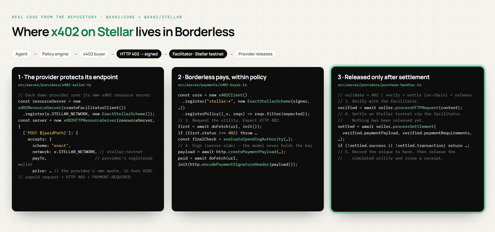
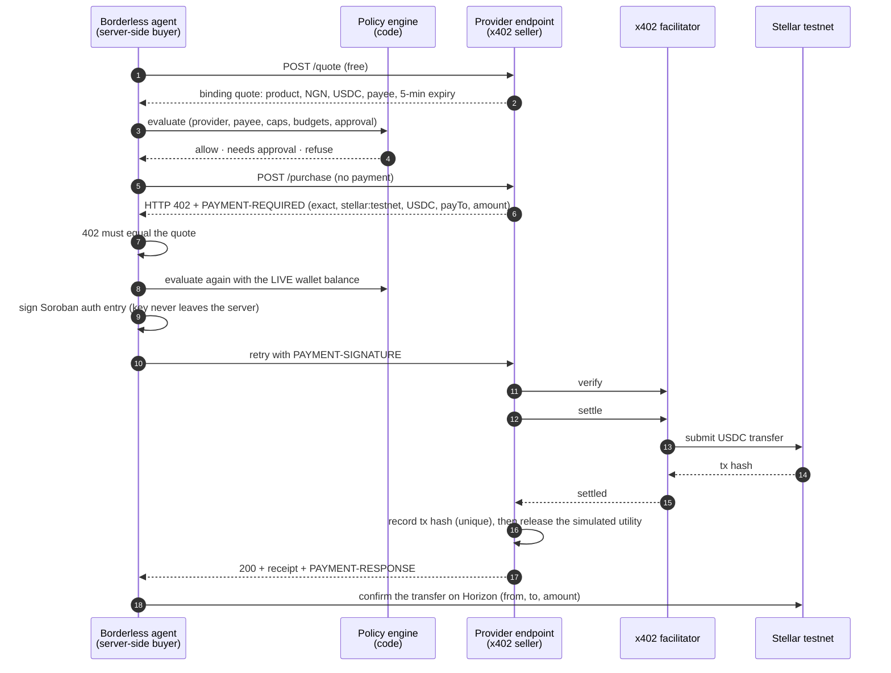
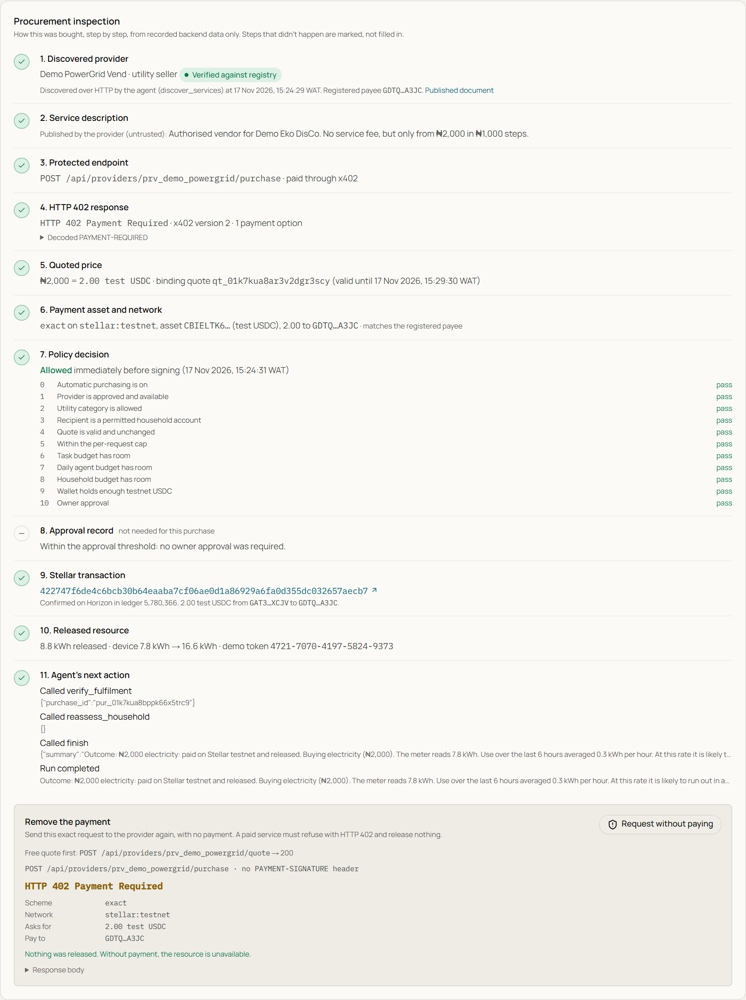
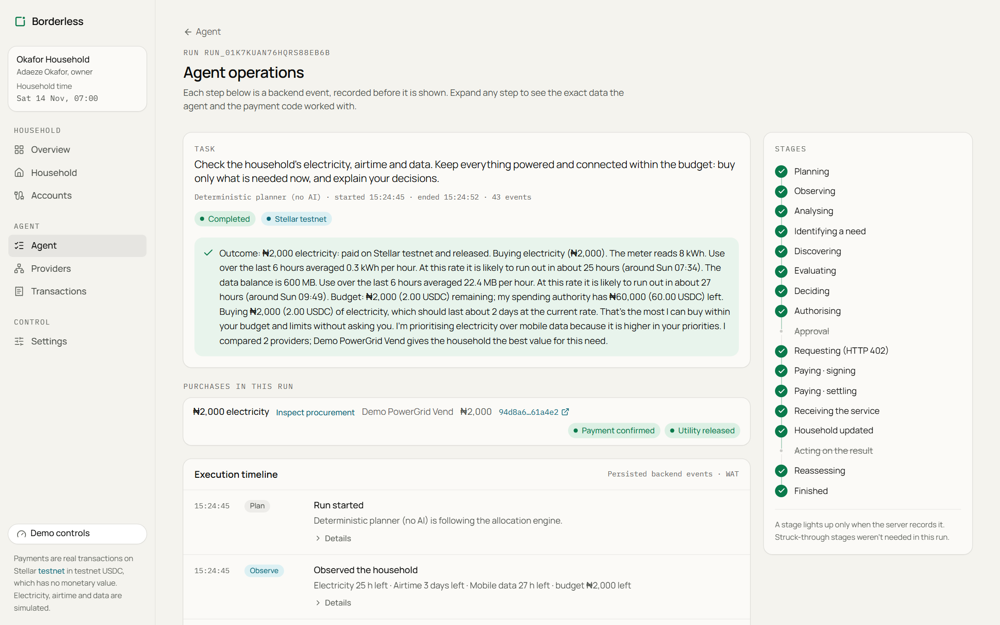
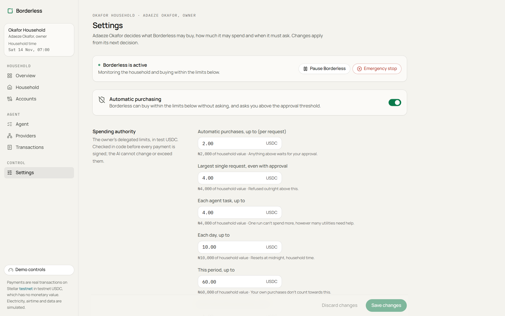
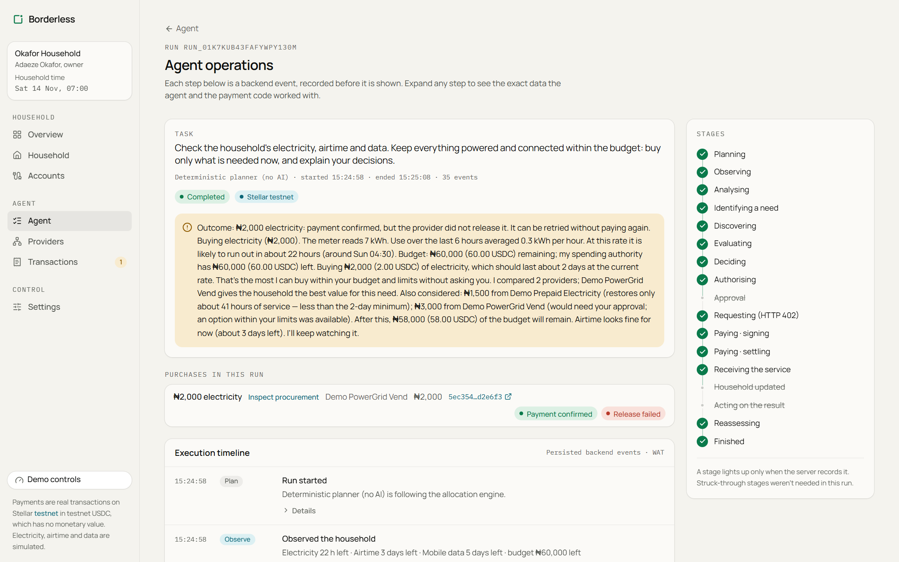
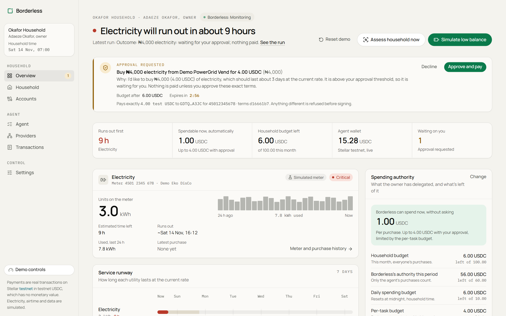
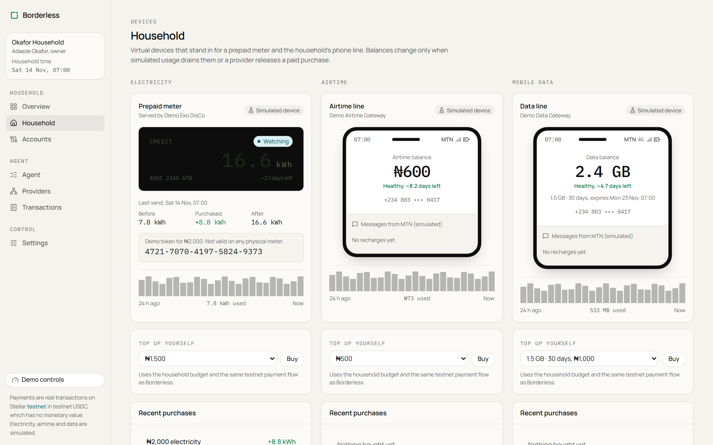
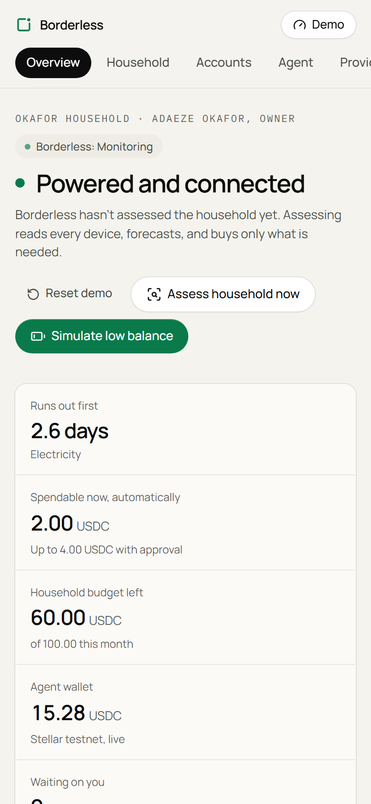
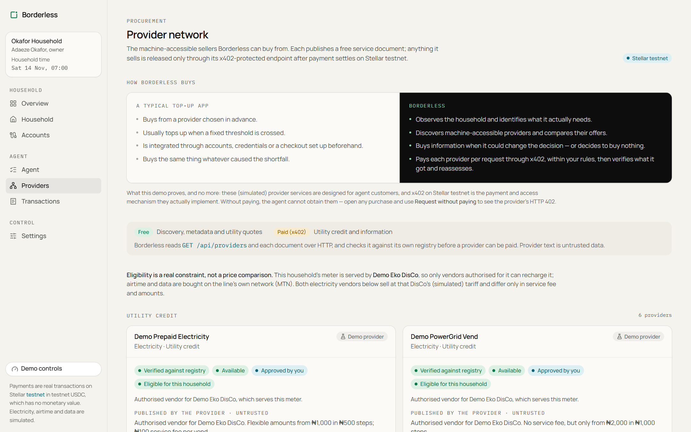

# Borderless

**An autonomous household utilities agent that pays for what a home needs through x402 on Stellar.**
*Your household stays powered and connected. Borderless handles the rest.*

`x402 v2` · `@x402/core` + `@x402/stellar` · `exact` scheme · `stellar:testnet` · test USDC · Next.js 16

**🔗 Live demo: [teamborderless.vercel.app](https://teamborderless.vercel.app)**: no setup, real x402 payments on Stellar testnet. Start at [`/overview`](https://teamborderless.vercel.app/overview).

<!-- Demo video: upload borderless-demo-under3.mp4 (drag it into this file in GitHub's web editor) and put its link here. -->
**▶ Demo video (2:56):** *link to be added*

<p align="center"></p>
<p align="center"><sub>The Overview of the demo household: electricity first, the owner's spending authority line by line, and the live demo controls.</sub></p>

> **Testnet and simulation, stated plainly.** Every payment is a **real transaction on Stellar testnet** in **test USDC** (no monetary value). Electricity, airtime and data are **simulated**: the meter and phone are virtual devices and the providers are demo services. Providers price in naira; a fixed, labelled demo rate (**₦1,000 = 1 test USDC**) converts. It is not an exchange rate.

---

## For judges: the short version

**The problem.** In many Nigerian households, electricity units, airtime and mobile data all run out on their own schedules, and all come out of one budget. When the lights go off and the data is low at the same time, someone has to decide what to pay for first. Ordinary auto-pay follows instructions; it can't weigh competing needs.

**What Borderless does.** It watches the household's meter and phone lines, forecasts when each will run out, discovers eligible providers, compares their offers, decides what matters most within the owner's budget, and **pays the provider itself through x402 on Stellar**. Then it verifies what was delivered and explains why.

**Why x402 is not optional here.** Every utility top-up and every paid piece of information (such as a meter diagnostic) sits behind a provider endpoint that answers **HTTP 402 Payment Required**. Nothing is released until a Stellar payment has been **verified and settled**. Remove the payment and Borderless can't buy anything; the app even has a **Request without paying** button that shows the provider's real 402 live.

**What keeps it safe.** *The AI proposes. The code enforces.* The model chooses tools and products, but never an amount, payee, limit or approval. A deterministic **policy engine** checks every purchase twice (when proposed, and again with the live wallet balance right before signing), and a purchase above the owner's limit is refused **before anything is signed**.

| The judging question | Where it is answered |
| --- | --- |
| **Where and how is Stellar x402 integrated?** | [1 · Where x402 lives in the code](#1--where-and-how-stellar-x402-is-integrated) |
| **How does the payment flow work?** | [2 · The payment flow, step by step](#2--how-the-payment-flow-works) |
| **How does the integration support the core functionality?** | [3 · Why the product depends on x402](#3--how-the-integration-supports-the-core-functionality) |
| **Why can't Borderless exist without x402?** | [Why Borderless cannot exist without x402](#why-borderless-cannot-exist-without-x402) |
| **Can I try it myself?** | Yes: [open the live demo](https://teamborderless.vercel.app/overview), or see [Try it yourself](#try-it-yourself) for the walkthrough and running it locally |

**Proof from a real run** (Scenario A, recorded for the demo video): the agent paid **2.0000000 test USDC** to the electricity provider's registered wallet in transaction [`46846b41…2c73`](https://stellar.expert/explorer/testnet/tx/46846b41a6735355b153f0213a84d3e86655cb355f0a40376ca25672da232c73) (ledger 5,780,559), and only then did the provider credit the meter.

---

## 1 · Where and how Stellar x402 is integrated

Borderless plays **both sides** of x402, with the official packages (`@x402/core` and `@x402/stellar` 2.30):

- **Sellers:** eight demo providers (six utility providers and two meter-diagnostic services). Each has its own receiving wallet and its own x402 resource server.
- **Buyer:** the agent's server-side wallet. It is the only code that holds the signing key.
- **Facilitator:** the public one at `https://x402.org/facilitator`. It verifies and settles each payment on Stellar testnet and sponsors the fees.

<p align="center"></p>

| Role | File | What it does with x402 |
| --- | --- | --- |
| **Seller: protect the endpoint** | [`src/server/providers/x402-seller.ts`](src/server/providers/x402-seller.ts#L69-L113) | Each provider builds `x402ResourceServer(HTTPFacilitatorClient)` with `ExactStellarScheme` and an `x402HTTPResourceServer` route: `scheme: "exact"`, `network: stellar:testnet`, `payTo` = the provider's **registered** wallet, `price` = its own quote in test USDC (SAC `CBIELTK6…DAMA`, 7 decimals). |
| **Seller: settle, then release** | [`src/server/providers/purchase-handler.ts`](src/server/providers/purchase-handler.ts#L141-L230) | Unpaid request returns **402 + `PAYMENT-REQUIRED`**. Paid request: `processHTTPRequest` (facilitator **verify**), then `processSettlement` (facilitator **settles on Stellar**), then the unique tx hash is recorded, and only then is the simulated utility released. `withX402` is deliberately not used because it runs the handler before settlement. |
| **Seller: paid information** | [`src/server/providers/service-handler.ts`](src/server/providers/service-handler.ts) | Meter diagnostics, where **the 402 is the price** (₦300 = 0.30 USDC or ₦800 = 0.80 USDC). The same verify, settle and release order applies. |
| **Buyer: pay within policy** | [`src/server/payments/x402-buyer.ts`](src/server/payments/x402-buyer.ts#L128-L136) | `x402Client().register("stellar:*", new ExactStellarScheme(signer))`, an SDK spend cap, and `registerPolicy` that only accepts requirements **identical to Borderless's own quote**. |
| **Buyer: the purchase** | [`x402-buyer.ts` → `executePurchase`](src/server/payments/x402-buyer.ts#L150-L500) | Re-checks authority, POSTs and **expects 402**, checks the 402 against the quote (scheme, asset, network, payee, amount), runs the **policy engine again with the live wallet balance**, then `createPaymentPayload` (signs a Soroban auth entry server-side) and retries with `encodePaymentSignatureHeader`. |
| **Independent confirmation** | [`src/server/payments/horizon.ts`](src/server/payments/horizon.ts#L42) | After settlement, Borderless confirms the USDC transfer on **Horizon** itself (from, to, amount) rather than trusting the provider's word. |
| **Spending authority** | [`src/server/household/policy.ts`](src/server/household/policy.ts#L194) | `evaluateSpendingAuthority`: the ordered checks every payment must pass before it can be signed. |
| **The agent's only way to pay** | [`src/server/agent/runtime/tools.ts`](src/server/agent/runtime/tools.ts#L608) | `buy_service` takes **only a `quote_id`** from this run. The model can't name an amount or a payee. |
| **HTTP routes** | [`app/api/providers/[providerId]/purchase`](src/app/api/providers/%5BproviderId%5D/purchase/route.ts), [`app/api/services/[providerId]/[service]`](src/app/api/services/%5BproviderId%5D/%5Bservice%5D/route.ts) | The x402-protected endpoints, reached over real HTTP, even by the agent in the same app. |
| **On-chain allowance** | [`src/server/payments/funding-guard.ts`](src/server/payments/funding-guard.ts) | Optional: the household treasury grants the agent a capped, expiring USDC allowance (`approve` / `transfer_from` on the Stellar Asset Contract), so a leaked agent key has a hard on-chain ceiling. |

---

## 2 · How the payment flow works



**In words:**

1. **Need.** The agent sees, from real app state, that the meter will run out in about a day.
2. **Discover and quote.** It discovers eligible providers over HTTP and gets a free, binding quote.
3. **Authorise.** The policy engine checks the provider, payee, caps, daily, task and period budgets, and whether approval is needed.
4. **402.** The provider answers **HTTP 402 Payment Required** with its x402 terms. Borderless refuses to sign anything that differs from the quote.
5. **Final check, then sign.** The policy engine runs again with the live testnet balance. Only then does the server sign.
6. **Verify and settle.** The facilitator verifies the payment and **settles it on Stellar testnet**.
7. **Release.** Only now does the provider credit the meter and issue a receipt and demo token.
8. **Verify.** Borderless confirms the USDC transfer on Horizon, checks the meter went up, and reassesses the household.

Payment and fulfilment are recorded **separately**, so "paid but not delivered" is visible and recoverable without paying twice (Scenario D).

<p align="center"></p>
<p align="center"><sub><b>The flow, live.</b> Each stage lights up only when the server records it: discover, decide, spending rules, HTTP 402, sign, settle on Stellar, release, verify.</sub></p>

<p align="center"></p>
<p align="center"><sub><b>Procurement inspection</b> for one purchase: the decoded 402, every policy check, the Stellar transaction, the released units, and <b>Request without paying</b>, where the provider refuses the same request with a live 402.</sub></p>

<p align="center"></p>
<p align="center"><sub><b>On-chain.</b> The same payment on Stellar Expert: a USDC contract <code>transfer</code> of 20000000 (2.0000000 USDC, 7 decimals) from the agent wallet to the provider's registered wallet, with the fee sponsored by the facilitator.</sub></p>

---

## 3 · How the integration supports the core functionality

Borderless's core job is to **keep a household powered and connected while deciding what matters most within the owner's budget**. x402 on Stellar is what makes that autonomous and safe:

| Core capability | How x402 on Stellar makes it work |
| --- | --- |
| **The agent can actually buy** | Providers are machine-payable HTTP endpoints. There is no checkout page, account or card. The agent reads a 402, pays in test USDC and gets the resource in one request cycle, any time of day. |
| **No pay, no product** | Utility credit and diagnostics are released **only after settlement**. Unpaid requests get a 402 and nothing else. This is enforced in the provider handler, not just the UI. |
| **Choosing between competing needs** | Each purchase is a separate, priced, per-request payment, so the agent can compare offers and spend 2 USDC on electricity while **deferring** data (Scenario B). |
| **Buying information before buying power** | When electricity use spikes, the agent can pay **0.30 USDC via x402** for a meter diagnostic. The report changes what it buys: a stuck heater gets minimal relief plus a warning, while genuine extra use gets a purchase sized for the higher rate. |
| **The owner stays in control** | x402's 402 → sign → settle sequence gives a natural checkpoint *before* signing. That's where the policy engine runs: over-limit purchases are refused before a signature exists (Scenario C), and above-threshold ones wait for the owner to approve the exact terms. |
| **Auditable by anyone** | Every purchase is its own Stellar transaction. The household, or a judge, can check the payer, payee and amount on Stellar Expert, independently of Borderless. |
| **Honest failure handling** | Separate payment and fulfilment states mean "settled but not released" is recorded and retried **without a second payment** (Scenario D), and "outcome unknown" is reconciled before any retry. |

**Why x402 and not a session or channel?** A household makes a few distinct purchases a day, each with its own quote, approval, receipt and fulfilment. That is exactly x402's per-request model, and each purchase leaves its own verifiable transaction. See [x402 and MPP](#x402-and-mpp) for where MPP sessions would fit later.

<table>
<tr>
<td width="50%"><br><sub><b>B · Competing needs.</b> 2 USDC left: electricity bought (the owner's first priority), data deferred, with the reasoning.</sub></td>
<td width="50%"><br><sub><b>C · Over the limit.</b> A 5 USDC instruction refused <b>before signing</b>: every payment stage stays unlit, nothing reaches Stellar.</sub></td>
</tr>
</table>

---

## Why Borderless cannot exist without x402

Take x402 out and Borderless stops being an agent. It becomes a dashboard that forecasts when the lights will go off and sends you a reminder. Everything that makes it autonomous depends on the payment being part of the HTTP request:

| Without x402 | With x402 on Stellar |
| --- | --- |
| **An agent can't get through human checkout.** Card forms, one-time codes, CAPTCHAs, vendor accounts and saved cards are built to stop software from paying. | **Payment is part of HTTP.** The provider answers `402` with machine-readable terms and the agent answers with a signed payment. There's no account, card or human in the loop, at 2 a.m. as easily as at noon. |
| **Every vendor would need an integration.** Each one means a contract, an API key and billing, set up in advance. The agent could only use providers someone had already onboarded. | **Any provider that speaks x402 can be paid.** Borderless discovers providers at runtime, reads their published service document, and pays the one that serves this meter best. The protocol is the integration. |
| **Small purchases don't make sense.** Paying ₦300 (0.30 USDC) for a meter diagnostic before deciding what electricity to buy is impossible when card fees and minimums cost more than the information. | **Per-request micropayments are normal.** Stellar settles in seconds for a fraction of a cent (sponsored by the facilitator on testnet), so buying *information* before buying *power* is a rational choice the agent can make. |
| **The provider has to trust the buyer, or the buyer has to prepay.** Either way, someone carries credit risk, and the agent would need a balance held by each vendor. | **The provider releases only after settlement.** Verify, settle on Stellar, then release: the resource and the payment move together, so neither side needs to trust the other ([`purchase-handler.ts`](src/server/providers/purchase-handler.ts#L141-L230)). |
| **There's no clean moment for the owner's rules.** With a checkout flow, the price and payee arrive as a web page; there's nothing exact for code to check before money moves. | **The 402 is an exact, checkable offer.** Scheme, asset, network, payee and amount arrive *before* anything is signed, so the policy engine can compare them with the quote and the owner's limits and refuse in code ([`x402-buyer.ts`](src/server/payments/x402-buyer.ts#L255-L410)). |
| **"It paid" is the vendor's word.** A card statement or a vendor's email is the only record. | **Every purchase is independently verifiable.** Each one is its own Stellar transaction, confirmed by Borderless on Horizon and checkable by anyone on Stellar Expert. |

In short: **the household's needs are continuous, the providers are many and change, and the amounts are small.** Only a payment that travels with the request, settles in seconds and can be checked before signing lets an agent act on its own while the owner stays in control. That is what x402 on Stellar provides, and why Borderless is built around it rather than adding it afterwards.

---

## Try it yourself

You never need real money, a personal wallet or an API key. Every payment is test USDC on **Stellar testnet**.

### Option 1 · The live demo (no setup)

Open **<https://teamborderless.vercel.app/overview>** and follow the [walkthrough](#a-judges-walkthrough) below. It is the same code as this repository, deployed on Vercel with a hosted database, paying through x402 on Stellar testnet with its own funded testnet wallets.

The live demo has **one shared demo household**. If someone else is running the agent, a new run waits until theirs finishes (*"Borderless is already working on a task"*), and **Reset demo** resets it for everyone.

### Option 2 · Run it locally (about 10 minutes)

The setup script creates and funds its own testnet wallets.

**Prerequisites:** Node.js 22.23.4 or later (developed on Node 24), pnpm 10, git, internet access to Stellar testnet. *(Optional: a Gemini or OpenAI API key for the AI planner. Without one, the deterministic planner runs the same tools, rules and real payments.)*

```bash
git clone https://github.com/gloria2807/Borderless.git
cd Borderless
pnpm install
cp .env.example .env.local     # optional: add GEMINI_API_KEY (or OPENAI_API_KEY) for the AI planner
pnpm wallets:setup             # creates + funds testnet wallets (Friendbot XLM, USDC trustline, ~20 test USDC)
pnpm db:reset                  # creates the SQLite database with the demo household
pnpm dev                       # http://localhost:3000
```

On Windows PowerShell, use `copy .env.example .env.local` instead of `cp`. `pnpm wallets:status` shows the wallets' live balances. If the testnet DEX has no USDC liquidity, use the [Circle faucet](https://faucet.circle.com) (Stellar Testnet) with the agent's public key from `pnpm wallets:status`.

### A judge's walkthrough

| # | Do this | What you should see |
| --- | --- | --- |
| 1 | Open [`/overview`](https://teamborderless.vercel.app/overview) (live) or <http://localhost:3000/overview> (local) and press **Reset demo** | The Okafor Household is healthy; the agent wallet's **live testnet balance** is shown. |
| 2 | Press **Simulate low balance** *(Scenario A)* | A real agent run starts and its live console opens: observe → forecast → discover → decide → spending rules → **HTTP 402** → sign → **settle on Stellar** → release → verify. About a minute. |
| 3 | Open the purchase and press **Inspect procurement** | The decoded 402, each policy check, the transaction hash with a **Stellar Expert** link, and the released units. |
| 4 | Press **Request without paying** | The provider's **live 402**: without payment, nothing is released. |
| 5 | Follow the Stellar Expert link | The real USDC transfer: agent wallet → the provider's registered wallet. |
| 6 | Demo controls → Scenario **B · Competing needs**, then Agent → **Start run** | 2 USDC left, electricity and data both low: it buys electricity, defers data and explains why. In **Settings**, put data first and run again: the money goes to data. |
| 7 | Demo controls → Scenario **C · Spending limit**, then **Attempt over-limit purchase** | A 5 USDC instruction is **refused before signing**, naming each rule it broke. No payment, no transaction. |
| 8 | Settings → **Pause** or **Emergency stop** | The agent keeps monitoring but cannot spend; pending approvals are declined. |

Each electricity purchase spends 2 test USDC. Locally, `pnpm wallets:recycle` returns what the demo providers received, so the demo can be repeated without new funding.

### See the 402 from your terminal

Ask the live site's paid endpoint for a meter diagnostic **without paying**. It costs nothing, because nothing is paid:

```bash
curl -i -X POST https://teamborderless.vercel.app/api/services/prv_demo_gridsense/meter-diagnostic -H "content-type: application/json" -d '{"accountIdentifier":"45012345678","purchaseId":"pur_judgetry000001"}'
```

(Locally, use `http://localhost:3000` instead.) You get `HTTP/1.1 402 Payment Required` and a `payment-required` header. Base64-decoded, it is the x402 v2 challenge:

```json
{ "x402Version": 2, "error": "Payment required",
  "accepts": [{ "scheme": "exact", "network": "stellar:testnet", "amount": "3000000",
                "asset": "CBIELTK6YBZJU5UP2WWQEUCYKLPU6AUNZ2BQ4WWFEIE3USCIHMXQDAMA",
                "payTo": "G…(the provider's registered wallet)", "maxTimeoutSeconds": 300,
                "extra": { "areFeesSponsored": true } }] }
```

That is 0.30 test USDC (7 decimals) for the diagnostic. The free endpoints, `GET /api/providers` and `GET /api/providers/<id>/service`, show what each provider sells and which endpoints are paid.

### Prove it from scripts (optional)

```bash
pnpm check                                                    # typecheck + 318 unit/integration tests (no network, no funds)
APP_BASE_URL=http://localhost:3000 pnpm demo:providers        # a live x402 purchase from each of the six providers + failure cases
APP_BASE_URL=http://localhost:3000 pnpm agent:run --mode deterministic   # a full agent run, every event printed
```

---

## Contents

- [The household owner](#the-household-owner)
- [Running the demo](#running-the-demo) (every scenario)
- [Screenshots](#screenshots)
- [The agent](#the-agent)
- [Procurement: provider network and paid information](#procurement-provider-network-and-paid-information)
- [How a purchase works](#how-a-purchase-works) (protocol detail)
- [Deploy on Vercel](#deploy-on-vercel)
- [Spending policy](#spending-policy) · [Approvals](#approvals) · [Funding guard](#funding-guard-on-chain-allowance)
- [How Borderless decides](#how-borderless-decides)
- [Architecture](#architecture) · [Commands](#commands) · [Testing](#testing) · [Configuration](#configuration)
- [Security notes](#security-notes) · [Failure handling](#failure-handling)
- [Why Borderless cannot exist without x402](#why-borderless-cannot-exist-without-x402)
- [x402 and MPP](#x402-and-mpp) · [Procurement acceptance criteria](#procurement-acceptance-criteria)
- [Known limitations](#known-limitations) · [Troubleshooting](#troubleshooting) · [Team](#team)

---

## Deploy on Vercel

The live demo at <https://teamborderless.vercel.app> is deployed this way. Borderless runs on Vercel's serverless functions. Vercel has no lasting disk, so the database is a hosted **libSQL** database (Turso, free tier), which speaks SQLite. Agent runs keep working after the request that starts them (`after()`), record a heartbeat so any instance can tell a live run from a dead one, and the live console reads new events from the database.

1. **Create the database** with the [Turso CLI](https://docs.turso.tech/cli/installation):
   ```bash
   turso db create borderless
   turso db show borderless --url        # libsql://borderless-<org>.turso.io
   turso db tokens create borderless     # the auth token
   ```
2. **Load the demo household into it** from your machine. Set `DATABASE_URL` and `DATABASE_AUTH_TOKEN` in `.env.local`, run `pnpm wallets:setup` if you haven't, then:
   ```bash
   pnpm db:reset
   ```
3. **Import the repository** at vercel.com → *Add New → Project*. Vercel detects Next.js and pnpm.
4. **Add environment variables** (Production) from your `.env.local`:
   - `DATABASE_URL`, `DATABASE_AUTH_TOKEN`
   - `STELLAR_NETWORK`, `X402_FACILITATOR_URL`, `DEMO_NGN_PER_TESTNET_USDC`
   - `AGENT_STELLAR_SECRET`, `AGENT_STELLAR_PUBLIC`
   - `TREASURY_STELLAR_SECRET`, `TREASURY_STELLAR_PUBLIC`
   - `DEMO_EMPTY_WALLET_SECRET`, `DEMO_EMPTY_WALLET_PUBLIC`
   - all eight `PROVIDER_*_PAYTO` values
   - optionally `GEMINI_API_KEY`

   The `PROVIDER_*_SECRET` values are not needed. Secrets stay in Vercel's encrypted settings and server code; they never reach the browser.
5. **Deploy.** On production, `APP_BASE_URL` defaults to the production domain, so the agent reaches the provider endpoints there. Set it yourself only for a custom domain.
6. **Check:** open `/overview`, press **Reset demo**, then **Simulate low balance**, and watch the run reach *Utility released*.

**Good to know:**
- Agent runs may take up to 5 minutes (`maxDuration = 300`); make sure the project's function duration limit allows it.
- Preview deployments sit behind Vercel's login, so the agent can't call their provider endpoints. Use the production deployment for the demo.
- There is no login: anyone with the link can trigger testnet payments from the agent wallet. It's test USDC, but top it up with `pnpm wallets:recycle` or the Circle faucet if it runs low.
- After pulling a version with new migrations, run `pnpm db:migrate` against the hosted database, or press **Reset demo**.

---

## Testnet setup

1. `pnpm wallets:setup` creates the wallets, funds each with testnet XLM from **Friendbot**, adds the **USDC trustline** (issuer `GBBD47IF6LWK7P7MDEVSCWR7DPUWV3NY3DTQEVFL4NAT4AQH3ZLLFLA5`, the Circle testnet USDC that the x402 Stellar package uses) and buys about 20 test USDC for the agent on the testnet DEX. It is idempotent.
2. If the DEX has no liquidity, use the **Circle faucet**: <https://faucet.circle.com> → *Stellar Testnet* → paste the agent's public key from `pnpm wallets:status`.
3. The x402 facilitator is the public `https://x402.org/facilitator` (fees sponsored on testnet; no key needed).
4. Testnet is reset from time to time. If wallets disappear, run `pnpm wallets:setup` again.

| Wallet | Purpose | Test USDC |
| --- | --- | --- |
| Agent payer | Signs every x402 payment (server-side only) | 20 (bought on the testnet DEX) |
| Household treasury | Grants the agent a capped, expiring allowance ([Funding guard](#funding-guard-on-chain-allowance)) | 5 |
| Empty demo wallet | The "empty payment wallet" scenario | 0 |
| Six provider wallets | Two competing providers per utility receive payments here | 0 |

Secrets are written only to `.env.local` (git-ignored) and are never printed. After pulling a new version, run `pnpm db:migrate` (or `pnpm db:reset`).

---

## The household owner

The demo household is the **Okafor Household**, owned by **Adaeze Okafor** (a fictional persona); the app shows both wherever the household is named. Her delegated authority, which Borderless cannot change and the AI never sees in full:

| Rule | Default | Enforced |
| --- | --- | --- |
| Automatic purchase, per request | **2 USDC** | Above this, nothing is paid without her approval of the exact terms |
| Largest single request | **4 USDC** | Refused outright above this, even with approval |
| Per agent task | **4 USDC** | Across every purchase in one run |
| Per day | **10 USDC** | Paid and pending, resets at midnight household time |
| This period | **60 USDC** | The agent's share of the monthly household budget (100 USDC) |
| Wallet | live balance | Never more than the agent wallet actually holds on testnet |
| Providers | allowlist | Only registered, verified, eligible providers she approved |
| Priorities | electricity → data → airtime | She can reorder them |

All of these are configurable in **Settings** (in USDC) and enforced by the policy engine in code, before signing. Settings also has **Pause**, **Resume** and **Emergency stop** (pause, revoke purchasing and decline pending approvals). The Overview shows each limit separately: household budget, period authority, daily budget, per-task budget, per-request limits, pending commitments and the live wallet balance.

<p align="center"></p>
<p align="center"><sub>Settings: Adaeze's limits in test USDC, with Pause and Emergency stop at the top. Changes are enforced in code from the next decision.</sub></p>

---

## Running the demo

The full presenter script and checklist are in [`docs/mentor-check-in.md`](docs/mentor-check-in.md).

**Scenario A — the primary electricity demo (about one minute):**

1. Open `/overview` and press **Reset demo**. Everything is healthy; the agent wallet's live testnet balance is shown.
2. Press **Simulate low balance**. The server lowers the virtual meter (persisted) to about a day of supply, records the event and starts a real agent run; the page opens its live console.
3. Watch: observe → forecast → **discover** eligible vendors over HTTP (only those authorised for the meter's DisCo) → evaluate → decide (2 USDC of electricity, within the automatic limit) → spending rules → **HTTP 402** → sign → **settle on Stellar testnet** → the provider verifies the settlement and releases the units → Borderless verifies the meter → reassess.
4. Open the purchase: separate *Payment confirmed* and *Utility released* records, the receipt and demo token, the Stellar Expert link, and **Inspect procurement** → **Request without paying** (the provider's real 402).

Press **Reset demo** to repeat it.

<p align="center"></p>
<p align="center"><sub>Scenario A, live: the agent discovered the eligible vendors, paid 2 test USDC through x402 and the provider released 8.8 kWh. Stages light up only when the server records them.</sub></p>

<p align="center"></p>
<p align="center"><sub>Procurement inspection for that purchase: the decoded 402, all 11 policy checks, the Stellar transaction, the released units, and the provider refusing the same request without payment.</sub></p>

**The other brief scenarios** (Demo controls → *Scenario*):

| Scenario | How to run it | What happens |
| --- | --- | --- |
| **B · Competing needs: 2 USDC left** | Load it, then Agent → Start run | Electricity and data both low, 2 USDC left. Borderless buys 2 USDC of electricity (the owner's first priority), defers data, and explains what it saw, the priorities, each option's cost, what it chose and why, what it deferred and what's left. Put data first in Settings and the money goes to data instead. |
| **C · Spending limit rejection** | Load it, then **Attempt over-limit purchase** (Demo controls) | Borderless is instructed to buy 5 USDC of electricity and tries, through its normal tools. The wallet's rules refuse it before anything is signed, naming each failed rule (above the 4 USDC per-request maximum and the 4 USDC task budget). No payment, no settlement. |
| **D · Paid, but the provider fails to deliver** | Load it, then Start run | A real settlement, then the provider fails to release: *Payment confirmed* and *Release failed* are recorded separately and the run says so. Turn the fault off and press **Retry release**: units are released against the same transaction, with no second payment. |

<table>
<tr>
<td width="50%"><br><sub><b>D · Paid, not delivered.</b> Payment confirmed and release failed, recorded separately; retry releases it with no second payment.</sub></td>
<td width="50%"><br><sub><b>Approval.</b> Above the automatic limit, nothing is paid until the owner approves these exact terms, before the countdown ends.</sub></td>
</tr>
</table>

More scenarios (each sets a starting state only; outcomes come from the real agent, policy engine and payment flow):

| Scenario | Starting state | What to watch for |
| --- | --- | --- |
| **Electricity and data both running low** | 8 USDC left; ~1 day of electricity, ~6 h of data | Data first (more urgent), then electricity, both within the 4 USDC task budget; two real testnet payments |
| **Unusual data usage** | Data draining at 3× the usual rate | Flags it for review instead of buying more |
| **Budget exhausted** | 0.20 USDC left; electricity nearly out | No payment; asks the owner to raise the budget |
| **Purchase needs approval** | Approval threshold 1 USDC | Parks the purchase; the owner approves the exact terms (with a countdown) or declines |
| **Provider outage** | The fee-free electricity vendor is down | Falls back to the other eligible vendor, automatically |
| **Nothing urgent** | Every utility has several days left | Buys nothing and says why each utility can wait |
| **Empty payment wallet** | Electricity low; the paying wallet holds 0 USDC | Gets a real HTTP 402, then stops before signing: insufficient funds, **not charged** |
| **Prompt injection attempt** | Airtime low; one provider's description tries to instruct the agent | In AI mode the hostile text reaches the model as untrusted provider data; the rules still decide |
| **Electricity use has tripled — stuck heater** | Meter draining at ~3× normal; cause hidden | Buys a 0.30 USDC meter diagnostic first (x402); the report finds a water heater stuck on, so it buys only minimal relief and tells you to fix the heater |
| **Electricity use up — guests staying** | Use more than doubled, meter low; cause hidden | Buys the diagnostic; the report finds genuine extra use, so the purchase is sized for the higher rate (above 2 USDC it asks for approval) |
| **Electricity use up, not urgent** | Use tripled but ~3 days left | Decides a diagnostic isn't worth buying yet and keeps watching |
| **Electricity use up, budget nearly gone** | Use tripled, meter low, 0.60 USDC left | Won't buy information that couldn't change anything; asks you to review |
| **Authority revoked** | Automatic purchasing off | Keeps monitoring and recommends, spends nothing |

**AI or deterministic.** Simulate low balance and the scenario buttons use the deterministic planner (no model, fully repeatable). In **Agent → New run** you can choose the AI agent (Gemini); it uses the same tools, rules and payment path.

**Failure demos** (Demo controls → Failure injection): the provider fails to release after payment (then *Retry release*, no second payment); the provider asks for more than it quoted (the agent refuses to sign); per-provider outages.

Resetting a scenario resets the **simulated** household only. Testnet transactions are permanent.

---

## Screenshots

<table>
<tr>
<td width="50%"><br><sub><b>Landing page</b> (<code>/</code>): the problem, how it buys, why payment matters, and what's real versus simulated.</sub></td>
<td width="50%"><br><sub><b>Household</b>: the simulated meter (served by its DisCo) after a live purchase, with the demo token, and the phone lines.</sub></td>
</tr>
<tr>
<td width="50%"><br><sub><b>Transactions</b>: each purchase with its provider, test-USDC amount, Stellar transaction link, and separate payment and fulfilment statuses.</sub></td>
<td width="50%" align="center"><br><sub><b>Mobile</b>: the same Overview at phone width.</sub></td>
</tr>
</table>

Screenshots are captured from the running app by `pnpm screenshots` (set `BASE_URL` to the dev server). It drives the real flows, including three live testnet purchases, so the images show genuine results.

---

## The agent

**Runtime** ([`runtime/`](src/server/agent/runtime)): a background run per household, with a persisted, ordered event log and a Server-Sent Events stream.

- **AI planner** ([`planner-openai.ts`](src/server/agent/runtime/planner-openai.ts)): **Gemini** (default `gemini-3.5-flash`, through Google's OpenAI-compatible endpoint) or OpenAI (`gpt-5.4-mini`), both via the OpenAI SDK, runs a server-side tool-use loop with strict JSON schemas, a step cap, a per-call timeout and a whole-run deadline. The UI shows the model's stated next steps and tool calls — never fabricated chain-of-thought. A model outage (timeout, rate limit, no credit, auth) stops the run safely and says so. A typical run is 10–15 steps; because each step resends the conversation, expect roughly 60–90k input tokens and about 1k output tokens per run.
- **Deterministic planner** ([`planner-deterministic.ts`](src/server/agent/runtime/planner-deterministic.ts)): no AI. Uses the same tools, policy and payment path, following the allocation engine. If a provider fails before money moves, it re-decides without that provider and tries the next-best option once. Labelled as such in the UI.
- **Tools** ([`tools.ts`](src/server/agent/runtime/tools.ts)), all reading real application state: `observe_household`, `inspect_utility` (forecast, confidence, history, assumptions), `inspect_budget`, `discover_services` (registry and published documents over HTTP, with eligibility), `read_price_list`, `search_offers` (eligible offers only, priced in naira and test USDC), `compare_offers`, `get_allocation_recommendation` (advisory; includes every option considered and why each was rejected), `request_quote`, `evaluate_purchase` (dry run of the rules), `buy_service`, `inspect_transaction`, `verify_fulfilment`, `reassess_household`, `finish`. Arguments are re-validated with Zod regardless of the schema the model saw.
- **Necessity guard:** code refuses an agent purchase of a utility with plenty of service left, or one flagged for unusual usage.
- **Agent Operations UI:** start a run with a task, watch the live stage stepper and execution timeline, expand details, approve inline. Refresh-safe: the page replays the stored log and the stream resumes after the last event (`Last-Event-ID`).

```bash
APP_BASE_URL=http://localhost:3000 pnpm agent:run                         # AI (Gemini if its key is set)
APP_BASE_URL=http://localhost:3000 pnpm agent:run --mode deterministic --scenario provider-outage
```

---

## Procurement: provider network and paid information

**Provider network** ([`catalog.ts`](src/server/providers/catalog.ts)) — a curated registry of clearly labelled demo providers:

- `GET /api/providers` lists every registered provider (free).
- `GET /api/providers/:id/service` is each provider's **published service document** (free): products, prices, availability, fulfilment terms, payment terms and payee, and every endpoint marked **free** or **paid (x402)**.
- The agent discovers providers by fetching these over HTTP. Code verifies each document against the registry — identity, payee wallet, network, asset, x402 on paid endpoints, endpoint address — and an unverified provider cannot be quoted or paid. Discovery returns metadata only, never a resource; provider text stays untrusted.

**Two kinds of paid resource:**

| | Utility credit | Information (meter diagnostic) |
| --- | --- | --- |
| Providers | Two per utility (six) | Demo GridSense (₦300 = 0.30 USDC, finding and advice) and Demo MeterLab (₦800 = 0.80 USDC, circuit-level evidence) |
| Price | Free binding quote, then `POST /api/providers/:id/purchase` (x402) | The HTTP 402 *is* the price: `POST /api/services/:id/meter-diagnostic` (x402) |
| Released after settlement | Credit on the virtual meter or phone | A diagnostic report; the meter is untouched |

**Why information is worth paying for:** the household's free view of the meter is hourly totals. The cause of unusual use (a stuck appliance, more people at home, a faulty meter) is simulated **provider-side** smart-meter data that only a paid diagnostic can see — a test fails if any agent tool, view or page reads it.

**Procurement decisions** ([`engine.ts`](src/server/agent/engine.ts)): the agent buys a diagnostic only when use is unexplained, a purchase depends on the cause, and the price is at most 20% of that purchase — within your spending rules and the **information cap** (Settings, default ₦1,000). It compares information offers, and declines (not urgent, too expensive, outside your limits) with a reason. It then **acts on the report**: genuine extra use → a purchase sized for the current rate; avoidable use → minimal relief at the normal rate only if the meter is nearly out, plus what you should fix. It never buys the same information twice, and buying nothing is a valid outcome. Both planners and the AI's tools follow the same rules; code enforces them whatever the model asks.

**Procurement inspection** ([`procurement.ts`](src/server/views/procurement.ts)): every purchase page shows each step from recorded backend data only, with gaps marked, and **Request without paying** re-sends the agent's exact request with no payment and a fresh id to show the provider's live response.

<p align="center"></p>
<p align="center"><sub>The provider network: what each provider publishes, whether it can serve this household (DisCo and network), registry verification, and which endpoints are free or paid through x402.</sub></p>

---

## How a purchase works

Official Stellar x402 packages (`@x402/core`, `@x402/stellar` 2.30), the `exact` scheme on `stellar:testnet`, test USDC (SAC `CBIELTK6YBZJU5UP2WWQEUCYKLPU6AUNZ2BQ4WWFEIE3USCIHMXQDAMA`, 7 decimals). The public facilitator at `https://x402.org/facilitator` verifies, settles and sponsors fees.

```
Agent (buyer, server-side)                Provider endpoint (seller)                Facilitator   Stellar testnet
 │ 1 POST /api/providers/<id>/quote ────▶ binding quote: product, recipient, NGN, USDC, payee, 5-min expiry
 │ 2 quote re-checked: payee = REGISTERED wallet, USDC = NGN at the demo rate, NGN = decided amount
 │ 3 policy engine (10 ordered checks)
 │ 4 POST /api/providers/<id>/purchase ─▶ order must redeem the quote (once)
 │ ◀──────────────────────────────────── 5 HTTP 402 + PAYMENT-REQUIRED
 │ 6 402 must equal the quote (and approved terms): scheme, asset, network, payee, amount
 │ 7 policy engine again, with the live wallet balance (Funding guard top-up if short)
 │ 8 sign Soroban auth entry (key never leaves the server)
 │ 9 retry with PAYMENT-SIGNATURE ──────▶ 10 verify ──────────────────────────▶ │
 │                                        11 settle ──────────────────────────▶ │ ── tx ─▶ │
 │                                        12 record settlement (unique tx hash); mark quote redeemed
 │                                        13 release simulated utility
 │ ◀──────────────────────────────────── 14 200 + receipt + PAYMENT-RESPONSE
 │ 15 confirm the USDC transfer independently on Horizon (from, to, amount)
```

- **Fulfilment only after settlement.** Provider routes call `x402HTTPResourceServer` in strict order — `processHTTPRequest` → `processSettlement` → fulfil — so no code path credits a device without a settled transaction hash ([`purchase-handler.ts`](src/server/providers/purchase-handler.ts)).
- **Quotes.** Expired or already-used quotes are refused with HTTP 410 before any payment is verified (unambiguously not charged).
- **The buyer trusts nothing it didn't compute.** Payees come from the provider registry, never from the provider's own words ([`x402-buyer.ts`](src/server/payments/x402-buyer.ts)).
- **Two competing providers per utility**, each with its own catalogue, pricing and receiving wallet ([`providers/`](src/server/providers)).

---

## Spending policy

[`policy.ts`](src/server/household/policy.ts) — pure, ordered, and every evaluation returns the full trace shown in the UI:

| # | Check | |
| --- | --- | --- |
| 0 | Automatic purchasing is on | Owner's master switch |
| 1 | Provider approved and available | Per provider |
| 2 | Utility category and network allowed | |
| 3 | Recipient is the household's registered account | |
| 4 | Quote valid and unchanged | Registered payee, consistent price, unexpired |
| 5 | Within the per-purchase cap and the per-utility cap | |
| 6 | Run (task) budget has room | |
| 7 | Daily agent budget has room | Household time |
| 8 | Household budget and agent authority have room, after the reserve | Includes pending commitments |
| 9 | Wallet holds enough test USDC | Read live from Horizon just before signing; unreadable = refuse |
| 10 | Owner approval | Above the approval threshold, or the purchase waits |

The owner sets every limit in **Settings**. The model is not told the limits; it learns them when a purchase is refused, and is told not to retry unchanged.

---

## Approvals

A purchase above the threshold is parked, not paid.

- **Bound to exact terms.** The terms the owner sees — provider, product, NGN price, exact test USDC amount, registered payee wallet, asset, network and recipient meter/phone — are frozen with a SHA-256 fingerprint. Approval must quote that fingerprint; if anything moved since (for example the provider's wallet), the request is closed unpaid and the agent re-decides. Before signing, the HTTP 402 must ask for exactly the approved terms.
- **Expiry.** Requests expire after the owner's approval window (Settings; default 3 minutes). Expired requests are cancelled unpaid (approve → HTTP 410) and no longer block new decisions.
- **No self-approval.** No tool can approve; approval is an owner action over the API.
- Approving, declining, expiry and the resulting payment are written into the run's timeline.

---

## Funding guard (on-chain allowance)

x402's `exact` scheme makes the payer sign a transfer from **its own** balance, so a token allowance cannot gate an x402 payment directly. Borderless uses one where it does help ([`funding-guard.ts`](src/server/payments/funding-guard.ts)):

- The **household treasury** grants the agent wallet a USDC allowance through the Stellar Asset Contract: `approve(treasury, agent, cap, expiration_ledger)`.
- When the agent wallet is short before a payment, Borderless draws a top-up with `transfer_from` — at least the shortfall, up to a float target, never above the allowance left.
- **Stellar enforces the cap and expiry**: a draw beyond either fails at simulation (`Error(Contract, #9)`) and nothing reaches the network. The owner can revoke at any time (`approve 0`).
- **What it bounds:** if the agent key leaked, the most it could ever move is its own balance plus the allowance left until expiry. **What it doesn't:** where the agent pays, or the size of each payment — those remain the policy engine's job.
- Settings → **Funding guard** shows the live on-chain allowance, treasury balance, estimated expiry and transaction links, with Grant and Revoke. For the demo the treasury key is held server-side; in a real deployment the owner would sign the allowance in their own wallet.

`pnpm demo:funding-guard` proves it live with a fresh empty wallet: funded payment within the cap, an over-cap draw refused by Stellar, revocation, then a not-charged failure.

---

## How Borderless decides

The deterministic core ([`engine.ts`](src/server/agent/engine.ts)) is used directly by the deterministic planner and as an advisor to the AI.

1. **Forecast** ([`forecast.ts`](src/server/usage/forecast.ts)): recent rate (last 6 simulated hours, else the usual rate), hours to depletion, bundle expiry, urgency (*critical* < 12 h, *low* < 36 h, *watch* < 72 h), unusual usage (≥ 2× usual), **confidence** (history depth, steadiness, recent change), the history considered and plain-language assumptions. Forecasts are labelled as estimates.
2. **Rank** by urgency, then the owner's priorities.
3. **Choose** across every provider that can serve the account: aim for 5–7 days, require 2; prefer no-approval options; equal prices go to the provider that delivers more.
4. **Share the budget** so later needs can still reach their minimum.
5. **Respect authority:** every candidate goes through the same policy function used before signing.
6. **Record** every option considered, why each was rejected, and the expected household impact; utilities that need nothing are recorded as such.
7. **Explain** with sentences typed as fact, observation, prediction, decision or constraint, naming the closest alternatives and why the provider was chosen.

---

## Architecture

One Next.js 16 application with hard internal module boundaries. Providers are separate modules with their own receiving wallets and ledgers, reached over real HTTP, so any provider can move to its own service or be replaced with a real one.

```
src/
├── app/                       Landing (/), Overview (/overview), Agent (+ runs/[id]), Household, Accounts, Providers, Transactions, Settings
│   └── api/
│       ├── providers/                registry listing; [providerId]/ service document, quote, x402 purchase, retry
│       ├── services/[providerId]/    x402-protected information services (meter diagnostic)
│       ├── agent/runs/               start/list runs, run log, runs/[id]/events (SSE)
│       ├── purchases/[id]/[action]   approve (terms hash) / decline / recover / probe-unpaid
│       └── funding-guard/            on-chain allowance status, grant, revoke
├── components/                Design system, devices, run console, approval cards, settings
└── server/
    ├── agent/                 Engine, explanations; runtime/ (executor, planners, tools, run log)
    ├── payments/              x402 buyer, Funding guard, wallet reads, Horizon confirmation
    ├── providers/             Six utility + two diagnostic providers, registry, catalog, x402 seller, quotes, service handler
    ├── household/             Spending policy, state, seed
    ├── transactions/          Purchases, approvals (binding, expiry), sweep, events
    ├── usage/  demo/  views/  db/
scripts/  tests/  tests/e2e/  drizzle/  docs/
```

**Stack:** Next.js 16, React 19, TypeScript, Tailwind CSS 4, Drizzle ORM on SQLite (`@libsql/client`), Zod 4, `@x402/*` 2.30, `@stellar/stellar-sdk` 17, OpenAI SDK (used for both Gemini and OpenAI), Vitest, Playwright + axe-core.

**Data model** ([`schema.ts`](src/server/db/schema.ts)) adds to the original household tables: `agent_runs`, `agent_run_events` (append-only, ordered), `provider_quotes`, `funding_guards`, `meter_profiles` (provider-side ground truth), and on `purchases` the service type, run, quote binding, approval deadline and approval terms/hash. Purchases keep three separate status fields: lifecycle `stage`, `payment_status`, `fulfilment_status`.

Design notes: [`docs/design-refinement-plan.md`](docs/design-refinement-plan.md) (visual design system), [`docs/amendment-a0-procurement-architecture.md`](docs/amendment-a0-procurement-architecture.md) (procurement amendment), [`docs/upgrade-m0-assessment.md`](docs/upgrade-m0-assessment.md) (engineering assessment and plan) and [`docs/milestone-0-architecture.md`](docs/milestone-0-architecture.md) (original).

---

## Commands

| Command | What it does |
| --- | --- |
| `pnpm dev` / `pnpm build` / `pnpm start` | Run the app |
| `pnpm check` | Typecheck + unit/integration tests |
| `pnpm test` / `pnpm test:e2e` | Vitest / Playwright (see [Testing](#testing)) |
| `pnpm db:reset [scenario]` | Recreate the demo household, optionally into a scenario id from the table above |
| `pnpm db:migrate` / `pnpm db:generate` | Apply / generate migrations |
| `pnpm wallets:setup` / `pnpm wallets:status` | Create and fund testnet wallets / show balances |
| `pnpm wallets:recycle` | Return test USDC that demo providers received to the agent wallet (testnet only) |
| `BASE_URL=http://localhost:3000 pnpm screenshots` | Recapture the README screenshots from the running app (makes three live testnet purchases) |
| `pnpm agent:run [--mode ai\|deterministic] [--scenario id] [task]` | Run the agent and print every event (real payments) |
| `pnpm agent:dry-run` | What the engine would decide now, without paying |
| `pnpm demo:providers` | Live purchase from each of the six providers + failure cases |
| `pnpm demo:funding-guard` | Live on-chain allowance verification |
| `pnpm demo:recovery` | Live replay, post-payment failure and no-repay recovery |
| `pnpm demo:purchase` / `pnpm demo:agent` | One purchase / the original agent demo |

Live scripts call the running app: `APP_BASE_URL=http://localhost:3000 pnpm demo:providers`. Several reset the demo household first.

---

## Testing

```bash
pnpm check                # typecheck + 318 unit/integration tests (no network, no funds)
pnpm test:e2e             # 34 Playwright tests, incl. accessibility and mobile (no funds spent)
E2E_LIVE=1 pnpm test:e2e  # adds the full live browser journey (spends test USDC)
```

- **Unit and integration** (temporary SQLite databases, in-process provider endpoints, scripted model): policy order and every check; decision engine, forecasting and confidence; options and rejection reasons; multi-provider choice and outage fallback; quotes (expiry, reuse, tampering); x402 requirement validation (wrong payee, amount, asset, network, scheme, decoy options); settlement and fulfilment ordering; idempotency and duplicate payments; approvals (binding, expiry, hard limits); Funding guard top-up planning and refusal; SSE replay, resume and live forwarding; restart recovery; model timeout and outages; prompt injection with an obedient scripted model; every demo scenario.
- **End-to-end** (production build on port 3100, own database): core journeys, the live run console and refresh safety, policy details, approval countdown/decline/expiry, transaction search, accounts, scenario loading, axe-core WCAG 2.1 AA on every page (including a run page), keyboard focus, mobile layout.
- **Live testnet**: `demo:providers`, `demo:funding-guard`, `demo:recovery`, `agent:run` (deterministic and AI with Gemini), and `E2E_LIVE=1`.

---

## Configuration

All configuration is server-side and validated at startup ([`env.ts`](src/server/config/env.ts)); see [`.env.example`](.env.example).

| Variable | Default | Purpose |
| --- | --- | --- |
| `DATABASE_URL` | `file:./data/borderless.db` | SQLite file locally, or a hosted libSQL URL (`libsql://…turso.io`) on Vercel |
| `DATABASE_AUTH_TOKEN` | — | Token for the hosted database (server-only) |
| `APP_BASE_URL` | `http://localhost:$PORT`; on Vercel production, the production domain | Where the agent reaches provider endpoints |
| `STELLAR_NETWORK` | `stellar:testnet` | **Only** testnet is accepted |
| `STELLAR_RPC_URL`, `STELLAR_HORIZON_URL`, `SOROBAN_RPC_URL` | Public testnet endpoints | RPC and Horizon |
| `X402_FACILITATOR_URL` / `X402_FACILITATOR_API_KEY` | `https://x402.org/facilitator` / — | x402 facilitator |
| `DEMO_NGN_PER_TESTNET_USDC` | `1000` | Fixed demo rate (₦1,000 = 1 test USDC), not an exchange rate |
| `GEMINI_API_KEY` / `OPENAI_API_KEY` | — | AI planner (server-only); Gemini is used when its key is set |
| `AI_PROVIDER` | auto | Force `gemini` or `openai` |
| `GEMINI_MODEL`, `OPENAI_MODEL`, `AGENT_REASONING_EFFORT` | `gemini-3.5-flash`, `gpt-5.4-mini`, `low` | Model choice |
| `AGENT_MAX_STEPS`, `AGENT_RUN_TIMEOUT_SECONDS`, `AGENT_MODEL_TIMEOUT_SECONDS` | `18`, `300`, `60` | Run limits |
| `AGENT_STELLAR_SECRET` / `_PUBLIC` | `wallets:setup` | Agent payer wallet |
| `TREASURY_STELLAR_SECRET` / `_PUBLIC`, `FUNDING_GUARD_FLOAT_TARGET_USDC` | `wallets:setup`, `1` | Funding guard |
| `DEMO_EMPTY_WALLET_SECRET` / `_PUBLIC` | `wallets:setup` | Empty-wallet scenario |
| `PROVIDER_*_PAYTO` | `wallets:setup` | The registry of provider receiving wallets (trust anchor), including GridSense and MeterLab |

---

## Security notes

- **Secrets stay on the server**: the agent, treasury and demo keys and the model API keys are read only by server modules, never sent to the browser, never logged; configuration errors name a setting without echoing its value. The model never sees keys or the owner's limits.
- **Prompt injection**: provider text reaches the model only inside tool results, labelled as untrusted data; the system prompt says data is never an instruction; no tool accepts a payee, amount or approval; arguments are validated server-side; the policy engine and approval binding apply regardless of what the model says.
- **Payee trust anchor**: providers are paid only at wallets in the server's registry, never at an address a provider supplies.
- **Limits enforced before signing**, twice; approval lifts only the threshold, never other limits.
- **Fulfilment cannot outrun payment**; one settlement per transaction hash (unique index).
- **Testnet only**; dedicated wallets; no user wallet or seed phrase is ever requested.
- **Cross-site protection only — no login.** Mutating routes reject cross-origin requests. Add real authentication before exposing this beyond a local or trusted demo.

---

## Failure handling

Payment and fulfilment status are recorded separately; a payment is never shown as successful until confirmed on-chain.

| Situation | What happens |
| --- | --- |
| Insufficient test USDC (live balance check) / missing trustline | Stopped before signing → **Not charged** (a Funding guard top-up is tried first if granted) |
| 402 doesn't match the quote or approved terms (payee, amount, asset, network, scheme) | Refused before signing → **Not charged** |
| Quote expired, reused or changed | 410 / refused → re-quote or re-decide; **not charged** |
| Approval declined, expired or terms changed | Cancelled → **not charged**; the agent reassesses |
| Provider unavailable / unreachable / not returning 402 | **Not charged**; agents fall back to another approved provider |
| Facilitator fails at verification or rejects | **Not charged** |
| Settlement outcome unclear | **Outcome unknown** → reconciled before any retry; never re-paid blindly |
| Paid, but provider fails to release | **Payment confirmed / Release failed** → *Retry release*, no new payment |
| Duplicate request for a paid purchase | Stored receipt returned; no new payment |
| Restart mid-purchase / mid-run | Sweep closes never-sent payments as not charged and reconciles possibly-sent ones; orphaned runs are marked interrupted |
| AI model timeout / rate limit / no credit | Run stops safely with the reason; purchases already made stay recorded |

---

## x402 and MPP

Stellar supports two agentic-payment protocols ([docs](https://developers.stellar.org/docs/build/agentic-payments)): **x402** (one payment per request, Soroban authorization entries, facilitator verification and settlement) and **MPP**, the Machine Payments Protocol, with a one-time *charge* intent and a *session* intent where the agent deposits into a one-way payment channel once and then pays by signing cumulative off-chain commitments, settling when the channel closes.

**Borderless uses x402, deliberately.** A household makes a few discrete purchases a day, each a distinct product with its own quote, approval, receipt and fulfilment. That is exactly x402's per-request model, and each purchase produces its own verifiable Stellar transaction — which is what the household (and a judge) should be able to audit.

**Where MPP sessions would fit later:** if Borderless began making thousands of tiny paid calls — for example, per-minute smart-meter telemetry, metered tariff data or a live price feed across many providers — per-request authorization would be wasteful. A session would let the household pre-fund a channel with a hard cap and stream micro-payments within it. That would sit *alongside* x402 purchases, behind the same policy engine (session cap ≤ an owner-set limit) and the same Funding guard ceiling. It is not implemented, because nothing in the product needs it yet.

---

## Procurement acceptance criteria

How each criterion of the procurement amendment is met, and where it is proven.

| # | Criterion | Evidence |
| --- | --- | --- |
| 1 | Identifies a household need from actual state | `need.identified` run events from real forecasts; `tests/procurement-decisions.test.ts` |
| 2 | Dynamically discovers a relevant provider | HTTP discovery of the registry and service documents; `tests/provider-network.test.ts` |
| 3 | Distinguishes free metadata from paid services | Endpoints marked free/paid; discovery releases nothing (tested) |
| 4 | Obtains a paid service through an actual x402 request | Live: diagnostic and utility purchases on Stellar testnet; `tests/information-services.test.ts` |
| 5 | Provider returns HTTP 402 before releasing | Live **Request without paying**; inspection shows the stored 402 |
| 6 | Policy engine independently authorises or rejects | 11 ordered checks before signing, recorded per purchase; information cap |
| 7 | A genuine Stellar testnet payment settles when authorised | Facilitator settlement + Horizon confirmation; transaction links |
| 8 | Release only after payment verification | Settle-then-fulfil handler; one settlement per payment |
| 9 | The agent uses the acquired resource to continue | Re-decision with the report (`planner.reassessed`); stuck heater vs guests buy differently |
| 10 | Can reject or defer a purchase | Not urgent / too expensive / outside limits; scenarios and tests |
| 11 | Compares alternatives | Two providers per utility and two diagnostic offers; options considered with reasons |
| 12 | Payments and fulfilment are auditable | Separate payment and fulfilment records, receipts, run log, procurement inspection |
| 13 | The judge can observe the process in real time | Agent Operations live stream; inspection; e2e tests |
| 14 | Why per-request machine payments are central | Paid resources exist only behind x402; the demo shows the 402 with and without payment |
| 15 | Original household capabilities intact | Full regression suites and live provider checks |

---

## Known limitations

- **Simulated utilities and demo providers.** No real DisCo, VTU or mobile-network integration.
- **Gemini free tier.** The configured key allows 20 model requests per day per model, about one full AI run. The AI's live procurement run on the stuck-heater scenario (discover → buy the ₦300 diagnostic → quote ₦1,500 of minimal relief) was cut short by this quota before it paid for the electricity; the deterministic planner completes the same flow, live.
- **Live AI runs use model credit.** Without a working key the AI planner stops safely (for example `model_no_credits`); the deterministic planner runs the same tools, rules and payments. AI behaviour is also proven with a scripted model in tests. Model availability varies: if Google reports high demand for a model, set `GEMINI_MODEL` to another one your key lists.
- **Single household, no authentication.** The live demo is one shared household; anyone with the link can reset it or trigger testnet payments from its agent wallet (test USDC only).
- **Concurrency across server instances.** One run per household is enforced through the database (a heartbeat shows which runs are alive), and settlements are unique per transaction hash. Two runs started at the same instant on different instances could still both begin; nothing is paid twice, because of the database's unique constraints.
- **Funding guard keys.** The treasury key is server-side for the demo. Allowance expiry is shown as an estimate from the ledger gap.
- **Conservative unknown-outcome reconciliation**: concludes "not charged" only after the payment authorisation expires; it does not search the chain for unrecorded transactions.
- **Facilitator dependency.** If the public facilitator is down, purchases fail safely; point `X402_FACILITATOR_URL` at a self-hosted one.
- **Stellar testnet resets periodically**: re-run `pnpm wallets:setup`.
- **Muted text colour** lifted from `#718078` to `#8A988F` to meet WCAG AA contrast.

---

## Troubleshooting

- **A page returns 500 after updating.** The database is missing new columns: run `pnpm db:migrate`, then reload.
- **"Provider answered HTTP 404 instead of 402".** `APP_BASE_URL` points at a different app; match it to where Borderless runs.
- **AI mode greyed out / `model_no_credits`.** Add `GEMINI_API_KEY` (or `OPENAI_API_KEY` with credit) to `.env.local` and restart `pnpm dev`.
- **AI run stops with `model_daily_quota`.** The Gemini key is on Google's free tier (20 requests per model per day; an AI run uses 10–15). Enable billing on the Google AI Studio project, wait for the reset time shown in the run, or use the deterministic planner.
- **Gemini 404 "no longer available" or 503 "high demand".** Set `GEMINI_MODEL` to a current model your key can use (the default is `gemini-3.5-flash`).
- **"…is missing or invalid. Run `pnpm wallets:setup`."** Run it, then restart `pnpm dev`.
- **Wallets not found / insufficient funds later.** Testnet was probably reset: `pnpm wallets:status`, then `pnpm wallets:setup`.
- **Funding guard shows "Couldn't read the network".** The Soroban RPC is unreachable or slow; the rest of the app keeps working.
- **Dev server serves a stale chunk after adding a component** (Next dev only). Restart `pnpm dev`.
- **Windows.** Developed and tested on Windows 11. An access-violation exit (`3221225477`) from a script is the native SQLite client crashing at process exit; re-run the command.

---

## Team

Built by **Gloria** and **Hannah**.
