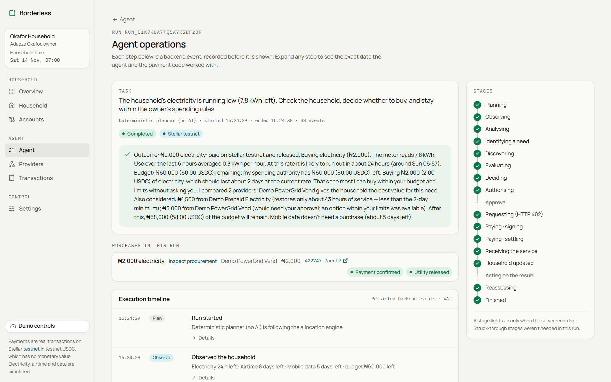
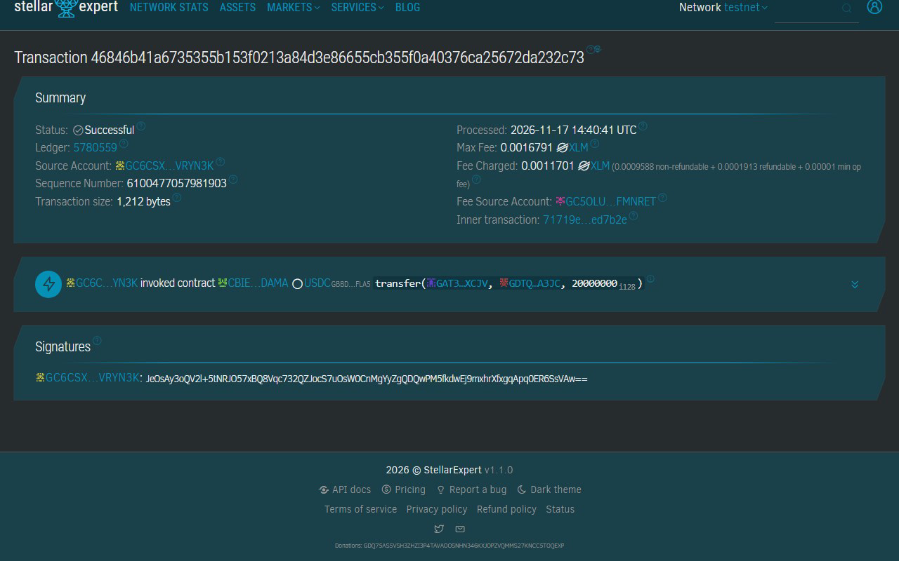

# Borderless

**An autonomous household utilities agent that keeps a home powered and connected, and pays for what it needs through x402 on Stellar.**

*Your household stays powered and connected. Borderless handles the rest.*

**Live demo:** [teamborderless.vercel.app](https://teamborderless.vercel.app). No setup needed; start at [/overview](https://teamborderless.vercel.app/overview).
**Demo video (2:56):** *link to be added*

`x402 v2` · `@x402/core` + `@x402/stellar` · `exact` scheme · `stellar:testnet` · USDC · Next.js 16

<p align="center">
  
</p>

> Every payment in Borderless is a real transaction on **Stellar testnet** in **test USDC**, which has no monetary value. The electricity meter, phone lines and providers are simulated, and prices in naira are converted at a fixed, labelled demo rate of **₦1,000 = 1 test USDC**.

---

## When the light goes off and the data follows

In Nigeria right now, nobody is spending money freely. Prices seem to climb every time you step into the market while salaries stay where they are, so most families have learnt to stretch whatever comes in until it reaches the end of the month. Every naira already has a job before it arrives, and the money for electricity units has to share the same small budget as data, food, transport and school fees.

Yet light and data are the two things a home can least afford to lose. For the many people who now work remotely, freelance for clients abroad or run a small business from their phone, a dead meter or an empty data plan is far more than an inconvenience, because it can mean a missed deadline, a client who quietly moves on, or a day's income that never arrives.

It always seems to happen at the worst moment. You are in the middle of a call or rushing to submit something important when the power goes off, and you assume it is NEPA (the name many Nigerians still use for the power company) until you check the meter and realise your units have finished. You reach for your phone to buy more, only to find a message telling you your data is almost gone as well, and now you are sitting in the dark with not quite enough money, working out which one you can bear to go without.

Wherever you are reading this from, you probably know some version of that feeling, whether it is the rent and the power bill falling due in the same week or a prepaid plan that runs out in the middle of something that matters. Borderless was built for that moment, so that a household's most important needs are watched over and paid for before anyone has to sit in the dark and choose.

## What Borderless does

Borderless keeps an eye on the household's electricity meter and phone lines, forecasts when each will run out, finds the providers that can serve the home and compares what they offer. Within the budget, priorities and limits the owner has set, it decides what to buy, pays the provider itself through x402 on Stellar, checks that what was paid for actually arrived, and explains its reasoning in plain language.

When there isn't enough to cover everything, it pays for what matters most and holds off on the rest. When usage suddenly jumps, it can pay a few hundred naira for a meter diagnostic to understand why before spending more on electricity. And when spending would be a mistake, it waits or asks the owner first.

## Naira on the surface, Stellar underneath

A fair question is why a family that earns, saves and thinks in naira would use a product built on Stellar. The answer is that they don't have to change how they think about money at all. Borderless shows every price in naira, the owner sets limits and priorities in amounts that make sense to them, and nobody needs to understand wallets, tokens or blockchains for the light to come back on.

Stellar does its work underneath. Each purchase is paid in USDC on Stellar, which settles in a few seconds for a tiny fraction of a cent, works at two in the morning as well as at noon, and doesn't depend on a card, a bank's opening hours or a failed transfer that takes days to reverse. A budget held in a dollar-backed stablecoin also holds its value from week to week in a way that cash put aside for bills often doesn't.

We believe this is how the blockchain reaches the people who stand to gain the most from it. Rather than asking a nurse in Ibadan or a remote developer in Lagos to become a crypto user, Borderless quietly makes the bills they already pay easier, cheaper and fairer to pay, and every household it serves becomes a Stellar user without having to think about it. In production, a household would fund its budget in naira through a Stellar anchor, the regulated on and off ramps that connect local bank accounts to USDC; in this demo, the fixed rate of ₦1,000 = 1 test USDC stands in for that step.

---

## How x402 on Stellar powers Borderless

Every electricity top-up, airtime or data bundle and paid meter diagnostic sits behind a provider endpoint that answers **HTTP 402 Payment Required**. The provider releases nothing until a Stellar payment has been verified and settled, so the payment isn't a checkout bolted onto an AI app; it is part of the request that gets the job done. The app even has a **Request without paying** button that sends the same request with no payment and shows the provider's real 402.

Borderless implements both sides of x402 with the official `@x402/core` and `@x402/stellar` packages (2.30): eight demo providers act as sellers, each with its own receiving wallet and x402 resource server; the agent's server-side wallet is the buyer and the only code that holds a signing key; and the public facilitator at `https://x402.org/facilitator` verifies and settles each payment on Stellar testnet and sponsors the fee.

<p align="center">
  
</p>

### Where it lives in the code

| Role | File | What it does |
|---|---|---|
| Seller: protect the endpoint | [`x402-seller.ts`](src/server/providers/x402-seller.ts#L69-L113) | Each provider builds an `x402ResourceServer` with `ExactStellarScheme` and an `x402HTTPResourceServer` route: `exact` scheme, `stellar:testnet`, `payTo` set to its **registered** wallet, and a price in USDC taken from its own quote. |
| Seller: settle, then release | [`purchase-handler.ts`](src/server/providers/purchase-handler.ts#L141-L230) | An unpaid request gets `402` with `PAYMENT-REQUIRED`. A paid one goes through `processHTTPRequest` (verify), then `processSettlement` (settle on Stellar); the unique transaction hash is recorded and only then is the utility released. |
| Seller: paid information | [`service-handler.ts`](src/server/providers/service-handler.ts) | Meter diagnostics (₦300 = 0.30 USDC, or ₦800 = 0.80 USDC), where the 402 itself is the price. |
| Buyer: pay within policy | [`x402-buyer.ts`](src/server/payments/x402-buyer.ts#L128-L136) | `x402Client` with `ExactStellarScheme`, an SDK spending cap, and a policy that only accepts payment terms identical to Borderless's own quote. |
| Buyer: the purchase | [`executePurchase`](src/server/payments/x402-buyer.ts#L150-L500) | Expects the 402, checks it against the quote, runs the policy engine again with the live wallet balance, signs a Soroban authorisation entry on the server and retries with `PAYMENT-SIGNATURE`. |
| Independent proof | [`horizon.ts`](src/server/payments/horizon.ts#L42) | Confirms the USDC transfer on Horizon (sender, recipient, amount) instead of trusting the provider's word. |
| Spending rules | [`policy.ts`](src/server/household/policy.ts#L194) | `evaluateSpendingAuthority`: the ordered checks every payment must pass before it can be signed. |
| The agent's only way to pay | [`tools.ts`](src/server/agent/runtime/tools.ts#L608) | `buy_service` accepts only a `quote_id` from the current run, so the model can never name an amount or a payee. |
| The HTTP endpoints | [`purchase/route.ts`](src/app/api/providers/%5BproviderId%5D/purchase/route.ts), [`[service]/route.ts`](src/app/api/services/%5BproviderId%5D/%5Bservice%5D/route.ts) | The x402-protected routes, reached over real HTTP even by the agent inside the same app. |

### How a payment flows

```mermaid
sequenceDiagram
    autonumber
    participant A as Borderless agent (buyer)
    participant P as Policy engine (code)
    participant S as Provider (x402 seller)
    participant F as x402 facilitator
    participant X as Stellar testnet
    A->>S: POST /quote (free)
    S-->>A: Binding quote: product, NGN, USDC, payee, 5-min expiry
    A->>P: Check provider, payee, caps, budgets, approval
    A->>S: POST /purchase (no payment)
    S-->>A: HTTP 402 + PAYMENT-REQUIRED
    A->>P: 402 must match the quote; check again with live wallet balance
    A->>A: Sign Soroban authorisation entry (key stays on the server)
    A->>S: Retry with PAYMENT-SIGNATURE
    S->>F: Verify, then settle
    F->>X: USDC transfer
    X-->>F: Transaction hash
    F-->>S: Settled
    S->>S: Record the hash, then release the utility
    S-->>A: 200 + receipt + PAYMENT-RESPONSE
    A->>X: Confirm the transfer on Horizon
```

The agent notices from real household data that, say, the meter has about a day left. It discovers the eligible providers, gets a binding quote and runs it past the policy engine. The provider answers with a 402, and Borderless refuses to sign anything that differs from the quote, then checks the owner's rules once more against the live wallet balance before signing. The facilitator verifies and settles the payment on Stellar, the provider credits the meter and issues a receipt, and Borderless confirms the transfer on Horizon and reassesses the household. Payment and delivery are recorded separately, so if a provider is paid but fails to deliver, the purchase can be completed later without paying twice.

<p align="center">
  
</p>
<p align="center"><sub>A live run. Each stage lights up only when the server records it: discover, decide, spending rules, HTTP 402, sign, settle on Stellar, release, verify.</sub></p>

**Proof from a real run:** in Scenario A, Borderless paid 2.0000000 test USDC to the electricity provider's registered wallet in transaction [`46846b41…2c73`](https://stellar.expert/explorer/testnet/tx/46846b41a6735355b153f0213a84d3e86655cb355f0a40376ca25672da232c73) (ledger 5,780,559), and only then did the provider credit the meter.

<p align="center">
  
</p>

### What it makes possible

Take x402 away and Borderless stops being an agent and becomes a dashboard that predicts when the light will go off and sends a reminder, leaving the person in the dark to do the rest.

| What Borderless needs | Why only x402 on Stellar gives it |
|---|---|
| **To pay without a human** | Card forms, one-time codes and vendor accounts are built to stop software from paying. With x402 the provider states its terms in a 402 and the agent answers with a signed payment, at any hour. |
| **To pay any provider it finds** | Borderless discovers providers at runtime and pays the one that serves the home best. Any provider that speaks x402 can be paid, with no contract, API key or onboarding in advance. |
| **Small payments that make sense** | Paying ₦300 for a meter diagnostic before deciding how much electricity to buy only works when the fee is a tiny fraction of a cent and settlement takes seconds. |
| **No payment, no product** | The provider releases the utility only after settlement, so neither side has to trust an unpaid promise. |
| **A checkpoint for the owner's rules** | The 402 states the exact scheme, asset, payee and amount before anything is signed, which gives the policy engine a precise moment to compare them with the quote and the owner's limits. |
| **Proof anyone can check** | Every purchase is its own Stellar transaction, confirmed by Borderless on Horizon and open to anyone on Stellar Expert. |

Borderless uses x402 rather than a payment channel because a household makes a handful of distinct purchases a day, each with its own quote, approval and receipt, which is exactly x402's one-payment-per-request model.

---

## The owner stays in control

*The AI proposes. The code enforces.* The model chooses which tools to use and what to buy, but it can never set an amount, choose a payee, change a limit or approve its own purchase. A deterministic policy engine checks every purchase twice, once when it is proposed and again with the live wallet balance just before signing. Anything above the owner's hard limit is refused before a signature exists, anything above the automatic threshold waits for the owner to approve the exact terms, and **Pause** or **Emergency stop** in Settings halts spending at once.

The demo household belongs to Adaeze Okafor, who lets Borderless pay up to 2 USDC on its own, up to 4 USDC per request with her approval, and up to 10 USDC a day, with electricity first, then data, then airtime.

<table>
<tr>
<td width="50%"><br><sub><b>Competing needs.</b> With 2 USDC left and both electricity and data running low, it buys electricity, the owner's first priority, and explains why data can wait.</sub></td>
<td width="50%"><br><sub><b>Over the limit.</b> A 5 USDC purchase is refused before signing, naming every rule it broke. Nothing reaches Stellar.</sub></td>
</tr>
</table>

---

## Try it

You don't need real money, a wallet or an API key; every payment uses test USDC on Stellar testnet.

**Live:** open **[teamborderless.vercel.app/overview](https://teamborderless.vercel.app/overview)**. It runs the same code as this repository. The live site has one shared demo household, so if someone else's run is in progress yours waits for it to finish, and **Reset demo** resets the household for everyone.

| # | Do this | What you'll see |
|---|---|---|
| 1 | On `/overview`, press **Reset demo**, then **Simulate low balance** | A real agent run in its live console: forecast, discover, decide, spending rules, HTTP 402, sign, settle on Stellar, release, verify. About a minute. |
| 2 | Open the purchase, then **Inspect procurement** | The decoded 402, every policy check, the released units and the transaction on Stellar Expert. |
| 3 | Press **Request without paying** | The provider's live 402. Without payment, nothing is released. |
| 4 | Demo controls → **B · Competing needs**, then **Start run** | Electricity bought, data deferred, with the reasoning. Put data first in Settings and run again to see the money follow the owner's priorities. |
| 5 | Demo controls → **C · Spending limit**, then **Attempt over-limit purchase** | Refused before signing. No payment, no transaction. |

**See the 402 from your terminal** (free, because nothing is paid):

```bash
curl -i -X POST https://teamborderless.vercel.app/api/services/prv_demo_gridsense/meter-diagnostic -H "content-type: application/json" -d '{"accountIdentifier":"45012345678","purchaseId":"pur_judgetry000001"}'
```

The response is `402 Payment Required`, and its `payment-required` header decodes (Base64) to the x402 v2 terms: `exact` scheme on `stellar:testnet`, 3000000 units of USDC (0.30, 7 decimals), payable to the provider's registered wallet, with fees sponsored.

**Locally** (about 10 minutes, with Node.js 22.23.4 or later and pnpm 10):

```bash
git clone https://github.com/gloria2807/Borderless.git
cd Borderless
pnpm install
cp .env.example .env.local     # on Windows PowerShell: copy .env.example .env.local
pnpm wallets:setup             # creates and funds its own testnet wallets
pnpm db:reset                  # loads the demo household
pnpm dev                       # http://localhost:3000
```

A Gemini or OpenAI key in `.env.local` turns on the AI planner; without one, a deterministic planner uses the same tools, rules and real payments. `pnpm check` runs the typecheck and 318 unit and integration tests, with no network or funds needed.

---

## Demo scenarios

Load any scenario from **Demo controls → Scenario**. Each sets a starting state only; what happens next comes from the real agent, policy engine and payments. **Simulate low balance** and the scenario buttons use the deterministic planner so they repeat reliably, and **Agent → New run** lets you choose the AI agent instead.

| Scenario | What happens |
|---|---|
| **A · Electricity running low** | About a day of units left: it finds the eligible vendors, pays 2 USDC through x402 and the meter is credited. |
| **B · Competing needs** | Electricity and data both low with 2 USDC left: it buys electricity, defers data and explains why. |
| **C · Over the limit** | Told to buy 5 USDC of electricity: refused before signing, naming every broken rule. |
| **D · Paid, not delivered** | Payment settles but the provider fails to release: recorded separately, then **Retry release** delivers with no second payment. |
| Electricity and data both low | 8 USDC left: two real payments, the more urgent one (data) first. |
| Electricity use tripled | Pays 0.30 USDC for a diagnostic. A stuck heater means minimal relief and a warning; guests staying means a purchase sized for the higher use (with approval above 2 USDC). Not urgent, or budget nearly gone: no diagnostic. |
| Unusual data usage | Flags it for review instead of buying more. |
| Budget exhausted, or authority revoked | Pays nothing and tells the owner why. |
| Purchase needs approval | Waits for the owner to approve the exact terms before a countdown ends. |
| Provider outage | Falls back to the other eligible provider. |
| Nothing urgent | Buys nothing and says why each utility can wait. |
| Empty payment wallet | Gets a real 402, then stops before signing: not charged. |
| Prompt injection | A provider's description tries to instruct the agent; the rules still decide. |

**Failure injection** (Demo controls) adds a provider that fails after payment, a provider that asks for more than it quoted (the agent refuses to sign) and provider outages. Resetting a scenario resets only the simulated household; testnet transactions are permanent.

## The agent and its tools

Each run executes in the background with an ordered, persisted event log that streams live to the run console, and the page replays it after a refresh. The **AI planner** (Gemini by default, or OpenAI) runs a tool-use loop with a step cap and timeouts, and shows its stated next steps and tool calls, never invented reasoning. The **deterministic planner** uses the same tools, rules and payments without a model.

The [tools](src/server/agent/runtime/tools.ts) all read real application state: `observe_household`, `inspect_utility`, `inspect_budget`, `discover_services`, `read_price_list`, `search_offers`, `compare_offers`, `get_allocation_recommendation`, `request_quote`, `evaluate_purchase` (a dry run of the rules), `buy_service`, `inspect_transaction`, `verify_fulfilment`, `reassess_household` and `finish`. Every argument is re-validated on the server, and code refuses a purchase when a utility still has plenty left or its usage looks abnormal.

## Paying for information

The household's free view of the meter is hourly totals, so the cause of a sudden jump (a stuck appliance, guests, a faulty meter) is only visible to a paid diagnostic. Two diagnostic services sell it through x402: GridSense (₦300 = 0.30 USDC) and MeterLab (₦800 = 0.80 USDC). The agent buys one only when usage is unexplained, the purchase depends on the cause and the price is at most 20% of that purchase, within an owner-set information cap. It then acts on the report, and never buys the same information twice.

## Spending policy and approvals

[`policy.ts`](src/server/household/policy.ts) runs eleven ordered checks on every payment, once when it is proposed and again with the live wallet balance just before signing:

0. Automatic purchasing is on.
1. The provider is approved and available.
2. The utility and network are allowed.
3. The recipient is the household's own meter or phone.
4. The quote is valid, unexpired and pays the registered wallet.
5. Per-purchase and per-utility caps.
6. The run's budget.
7. The daily budget.
8. The household budget and agent authority, including pending commitments.
9. The wallet holds enough USDC (read live; unreadable means refused).
10. Owner approval above the threshold.

The model is never told the limits; it learns them only when refused. A purchase that needs approval is parked unpaid, and the exact terms the owner sees (provider, product, naira and USDC amounts, payee, network, recipient) are fingerprinted, so if anything changes before approval the request closes unpaid. Approvals expire after the owner's window (3 minutes by default), and no tool can approve; only the owner can.

## Funding guard

x402's `exact` scheme pays from the agent's own balance, so Borderless adds an on-chain ceiling where it helps. The household treasury grants the agent wallet a capped, expiring USDC allowance through the Stellar Asset Contract (`approve`), and the agent tops itself up with `transfer_from` only when it is short. Stellar itself enforces the cap and expiry, so even a leaked agent key could never move more than its balance plus the remaining allowance. The owner can grant or revoke it in **Settings → Funding guard**, and `pnpm demo:funding-guard` proves it live.

## How Borderless decides

The [decision engine](src/server/agent/engine.ts) forecasts each utility from recent usage (hours left, urgency, unusual use and a confidence level), ranks needs by urgency and the owner's priorities, and compares every provider that can serve the account, aiming for 5 to 7 days of supply. It shares the budget so later needs can still be met, checks every option against the same policy used before signing, records each option it rejected and why, and explains its choice in plain sentences.

---

## Architecture

Borderless is a single Next.js 16 application with clearly separated internal modules. Providers are independent modules with their own receiving wallets and ledgers, reached through real HTTP requests, so an individual provider can later move to its own service or be replaced with a real one.

```text
src/
├── app/                      Landing, Overview, Agent (+ runs/[id]), Household, Accounts,
│   │                         Providers, Transactions, Settings
│   └── api/
│       ├── providers/        Registry, service documents, quotes, x402 purchases, retries
│       ├── services/         x402-protected information services (meter diagnostic)
│       ├── agent/runs/       Start and list runs, run logs, live events (SSE)
│       ├── purchases/        Approve, decline, recover, unpaid probe
│       └── funding-guard/    On-chain allowance status, grant, revoke
├── components/               Design system, devices, run console, approval cards, settings
└── server/
    ├── agent/                Engine, explanations; runtime/ (executor, planners, tools, run log)
    ├── payments/             x402 buyer, funding guard, wallet reads, Horizon confirmation
    ├── providers/            Six utility and two diagnostic providers, registry, x402 seller
    ├── household/            Spending policy, state, seed
    ├── transactions/         Purchases, approvals, sweep, events
    └── usage/  demo/  views/  db/
scripts/  tests/  tests/e2e/  drizzle/  docs/
```

| Area | Technology |
|---|---|
| Application and UI | Next.js 16, React 19, TypeScript, Tailwind CSS 4 |
| Database | SQLite locally and hosted libSQL (Turso) on Vercel, with Drizzle ORM |
| Payments | `@x402/core` and `@x402/stellar` 2.30, `@stellar/stellar-sdk` 17 |
| AI | Gemini or OpenAI through the OpenAI SDK, or a deterministic planner |
| Validation and tests | Zod 4, Vitest, Playwright with axe-core |

The [data model](src/server/db/schema.ts) keeps an append-only log of every agent run, the providers' binding quotes and the funding guard, and gives each purchase three separate statuses (its stage, its payment and its fulfilment), so a payment is never mistaken for a delivery.

---

## Deploy on Vercel

The live demo runs on Vercel with a hosted libSQL database (Turso), because serverless functions have no lasting disk. Agent runs keep working after the response that starts them, record a heartbeat in the database, and the live console reads new events from the database, so it all works across server instances.

1. Create a database at [app.turso.tech](https://app.turso.tech) and copy its URL and an auth token.
2. Put them in `.env.local` as `DATABASE_URL` and `DATABASE_AUTH_TOKEN`, then run `pnpm db:reset`.
3. Import the repository on Vercel and add the environment variables from `.env.local` (database, Stellar, facilitator, demo rate, the agent, treasury and empty-wallet keys, the eight `PROVIDER_*_PAYTO` values and optionally `GEMINI_API_KEY`). The `PROVIDER_*_SECRET` values aren't needed.
4. Deploy. `APP_BASE_URL` defaults to the production domain; use the production deployment, because preview deployments sit behind Vercel's login.

## Commands and testing

| Command | What it does |
|---|---|
| `pnpm dev` / `pnpm build` / `pnpm start` | Run the app |
| `pnpm wallets:setup` / `wallets:status` / `wallets:recycle` | Create and fund testnet wallets, show balances, return spent test USDC to the agent |
| `pnpm db:reset [scenario]` / `db:migrate` | Reset the demo household (optionally into a scenario) / apply migrations |
| `pnpm agent:run [--mode ai\|deterministic] [--scenario id]` | Run the agent from the terminal and print every event |
| `pnpm demo:providers` / `demo:funding-guard` / `demo:recovery` | Live x402 purchases from every provider, the on-chain allowance, and failure recovery |
| `pnpm check` | Typecheck and 318 unit and integration tests (no network, no funds) |
| `pnpm test:e2e` | 34 Playwright tests, including accessibility and mobile; `E2E_LIVE=1` adds a live journey that spends test USDC |

The tests cover the policy and every check, decisions and forecasting, quotes, x402 requirement validation (wrong payee, amount, asset, network or scheme), settle-before-release, duplicate payments, approvals, the funding guard, live streaming and restarts, model outages, prompt injection and every demo scenario.

## Configuration

All settings are server-side and validated at startup ([`env.ts`](src/server/config/env.ts)); [`.env.example`](.env.example) lists them all, and `pnpm wallets:setup` fills in the wallet values.

| Variable | Purpose |
|---|---|
| `DATABASE_URL`, `DATABASE_AUTH_TOKEN` | Local SQLite file, or a hosted libSQL URL and token |
| `APP_BASE_URL` | Where the agent reaches the providers (defaults to this server, or the Vercel production domain) |
| `STELLAR_NETWORK` | `stellar:testnet`; any other network is rejected |
| `X402_FACILITATOR_URL` | Defaults to `https://x402.org/facilitator` |
| `DEMO_NGN_PER_TESTNET_USDC` | The fixed demo rate, 1000 |
| `AGENT_STELLAR_*`, `TREASURY_STELLAR_*`, `DEMO_EMPTY_WALLET_*`, `PROVIDER_*_PAYTO` | Testnet wallets and the providers' registered receiving addresses |
| `GEMINI_API_KEY` or `OPENAI_API_KEY`, `GEMINI_MODEL`, `AGENT_MAX_STEPS`, `AGENT_RUN_TIMEOUT_SECONDS` | AI planner and run limits |

## Security

Keys for the agent, treasury and AI provider are read only by server code and are never sent to the browser, logged or shown to the model. Providers are paid only at wallets in the server's own registry, never at an address a provider supplies. Provider text reaches the model labelled as untrusted data, and no tool accepts an amount, payee or approval. Limits are enforced twice before signing, a resource is never released before settlement, and each transaction hash can settle only one purchase. The app is testnet-only, never asks for a user's wallet or seed phrase, and blocks cross-site requests, but it has no login, so anyone with the live link can use the demo household.

## Failure handling

Payment and delivery are recorded separately, and a payment is never shown as successful until it is confirmed on-chain.

| Situation | Outcome |
|---|---|
| Not enough USDC, a 402 that doesn't match the quote, or an expired or reused quote | Stopped before signing: **not charged** |
| Approval declined, expired or terms changed | Cancelled, **not charged**; the agent reassesses |
| Provider down or not returning a 402 | **Not charged**; falls back to another approved provider |
| Settlement outcome unclear | Marked **outcome unknown** and reconciled before any retry, never paid twice blindly |
| Paid, but the provider fails to release | **Payment confirmed, release failed**; retry delivers without paying again |
| Restart mid-run or mid-purchase | Unsent payments closed as not charged, possibly sent ones reconciled, dead runs marked interrupted |
| AI model timeout or outage | The run stops safely; completed purchases stay recorded |

## x402 versus MPP

Stellar supports two [agentic payment protocols](https://developers.stellar.org/docs/build/agentic-payments): **x402**, one payment per request settled by a facilitator, and **MPP**, which adds sessions where an agent funds a payment channel once and then streams many tiny off-chain payments. Borderless uses x402 because a household makes a few distinct purchases a day, each with its own quote, approval, receipt and on-chain transaction. MPP sessions would fit later if Borderless started paying for high-frequency data such as per-minute meter readings, behind the same policy engine and funding guard.

## Acceptance criteria

| Criterion | Evidence |
|---|---|
| Identifies a need from real household state | `need.identified` events from real forecasts; procurement decision tests |
| Discovers providers and tells free from paid | HTTP discovery of service documents, verified against the registry |
| Obtains a paid resource through a real x402 request | Live utility and diagnostic purchases on Stellar testnet |
| The provider answers 402 before releasing anything | **Request without paying**, and the stored 402 in inspection |
| Policy authorises or rejects independently | Eleven ordered checks before signing, recorded per purchase |
| A real testnet payment settles, then the resource is released | Facilitator settlement, Horizon confirmation, settle-then-fulfil handler |
| Uses what it bought, and can defer or refuse | Re-decides after a diagnostic; defers and refuses with reasons |
| Compares alternatives | Two providers per utility and two diagnostic offers, with rejected options recorded |
| Auditable and observable in real time | Separate payment and delivery records, receipts, live run stream and inspection |

## Known limitations

- Utilities and providers are simulated; there is no integration with a real power company, VTU provider or mobile network.
- The live demo is one shared household with no login.
- The Gemini free tier allows about one full AI run a day; the deterministic planner runs the same flow without a model.
- The treasury key for the funding guard is held on the server for the demo; in a real deployment the owner would sign the allowance in their own wallet.
- An uncertain payment is concluded "not charged" only after its authorisation expires.
- If the public facilitator is down, purchases fail safely; `X402_FACILITATOR_URL` can point to a self-hosted one.
- Stellar testnet resets from time to time; run `pnpm wallets:setup` again.

## Troubleshooting

| Problem | Fix |
|---|---|
| A page returns 500 after updating | `pnpm db:migrate`, then reload |
| "Provider answered HTTP 404 instead of 402" | Set `APP_BASE_URL` to where Borderless is running |
| AI mode unavailable, `model_no_credits` or `model_daily_quota` | Add a Gemini or OpenAI key with credit and restart, or use the deterministic planner |
| A wallet setting is missing, or wallets disappeared | `pnpm wallets:status`, then `pnpm wallets:setup` (testnet may have reset) |
| A Windows script exits with `3221225477` | The native SQLite client crashed on exit; run it again |

The [technical reference](docs/technical-reference.md) has the full detail behind every section.

---

## Team

Built by **Gloria** and **Hannah**.
