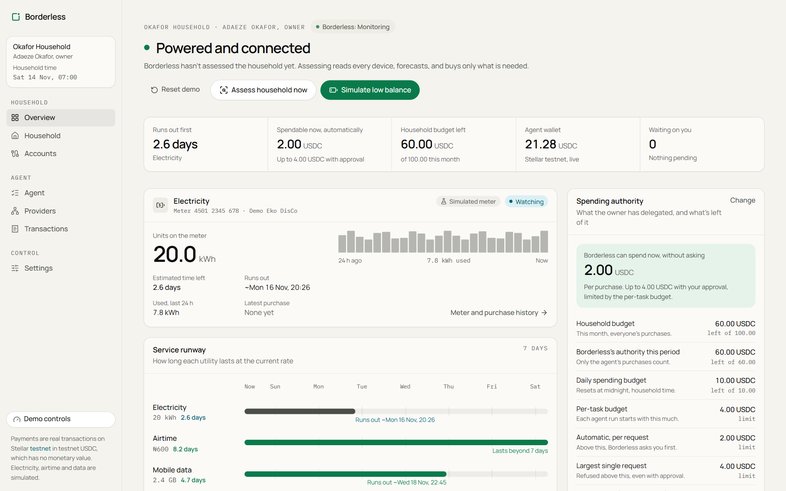
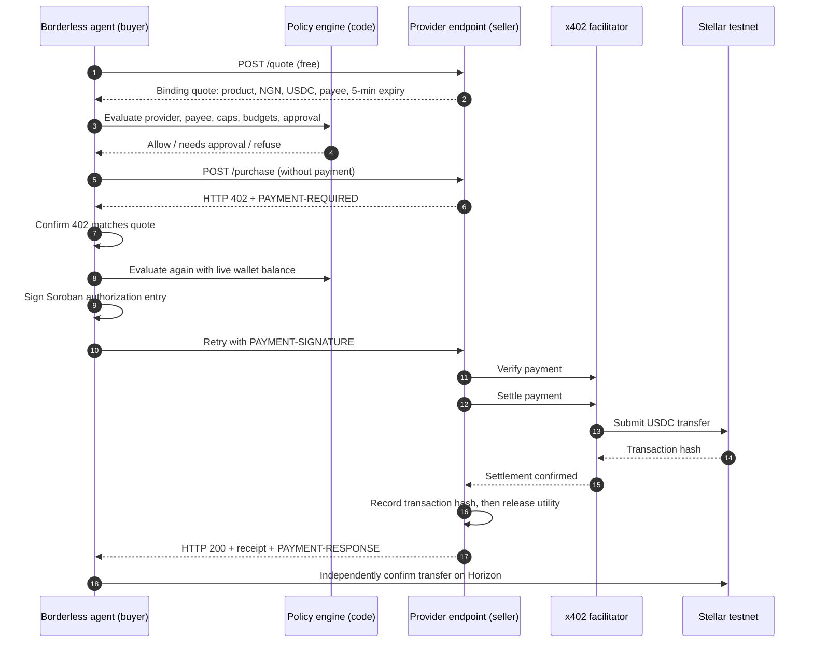
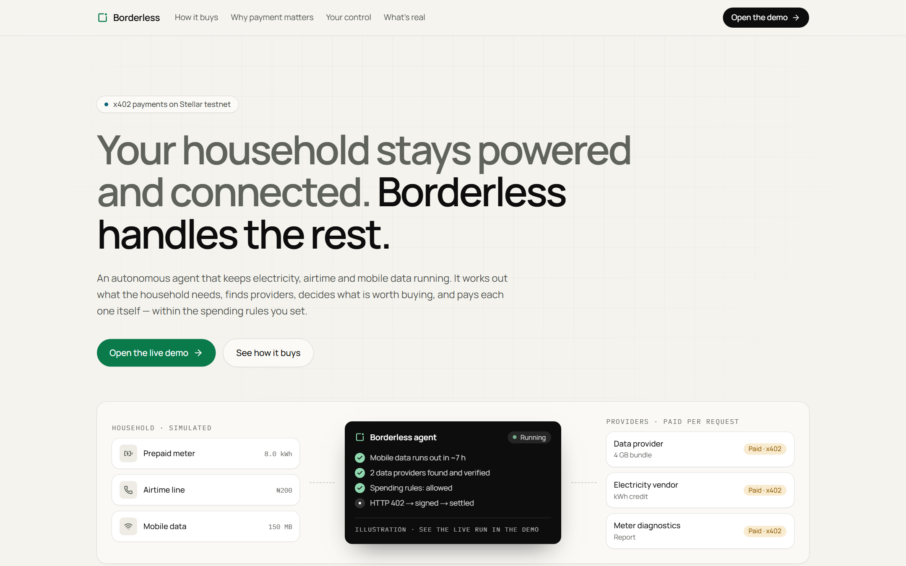
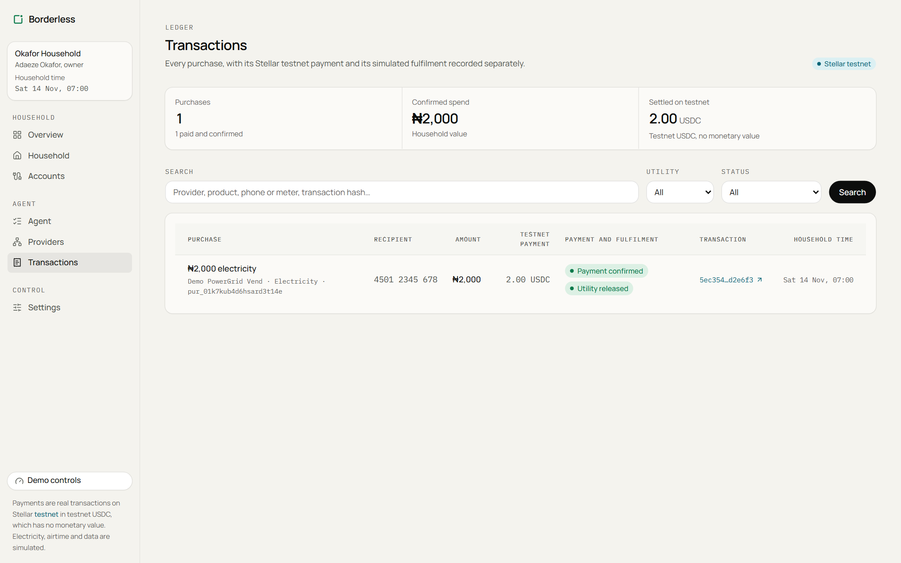

# Borderless

**Your electricity is almost gone. Your data is finishing. Airtime is another expense. Your wallet can't cover everything. What gets paid first?**

If you live in Nigeria, you probably know this situation too well.

You check your prepaid meter and realise there are barely enough units left to get through the day. Your mobile data is running low too, and you still need it for work, communication and everything else that depends on having an internet connection. Then there's airtime, because somehow that needs topping up as well.

You have limited money, so you start calculating. Do you buy electricity first and hope the data lasts? Do you recharge your data and manage without power for a while? Do you split the money between both and risk running out of everything sooner?

It's a familiar problem: too many bills, too many competing needs, and one household budget.

**Borderless is an autonomous household utilities agent that makes these decisions and pays for what a home needs through x402 on Stellar.**

It monitors household utilities, forecasts when they'll run out, compares available providers, considers the owner's priorities and spending limits, and purchases what the household needs. It also knows when to wait, when to ask for approval and when spending money would be a bad idea.

Your household stays powered and connected. Borderless handles the rest.

`x402 v2` · `@x402/core` + `@x402/stellar` · `exact` scheme · `stellar:testnet` · test USDC · Next.js 16

**Live demo:** [teamborderless.vercel.app](https://teamborderless.vercel.app)

No setup required. The live demo makes real x402 payments on Stellar testnet. Start at [/overview](https://teamborderless.vercel.app/overview).

**Demo video (2:56):** *Link to be added.*

<p align="center">
  
</p>

<p align="center">
  <sub>The Okafor Household at a glance: electricity first, the owner's spending authority and the controls for trying the live demo.</sub>
</p>

> **A note on what's real and what's simulated.**
>
> Every payment is a **real transaction on Stellar testnet**, using **test USDC**, which has no monetary value.
>
> Electricity, airtime and mobile data are simulated. The meter and phone are virtual devices, and the providers are demo services. Providers price their services in naira, converted using a fixed, clearly labelled demo rate of **₦1,000 = 1 test USDC**. This is not a real-world exchange rate.
>
> The payment infrastructure is real. The household utilities and their fulfilment are simulated.

---

## For judges: the short version

### The problem

In many Nigerian households, electricity units, airtime and mobile data run out at different times, but they all compete for the same limited budget.

When the lights are about to go off and the data is almost finished, someone has to decide which one gets paid for first. Ordinary auto-pay systems can follow instructions, but they cannot weigh competing household needs, compare alternatives and adjust spending as circumstances change.

### What Borderless does

Borderless monitors a household's utility balances, forecasts when each service will run out, discovers eligible providers, compares their offers, and decides what to purchase within the owner's budget.

It then **makes the purchase itself through x402 on Stellar**, verifies that the provider delivered what was paid for, and explains its decision.

It can also purchase information before making a decision. For example, when electricity consumption suddenly increases, it can pay for a meter diagnostic to investigate the cause before spending more on electricity.

### Why x402 is essential

Every utility purchase and every paid piece of information sits behind a provider endpoint that returns **HTTP 402 Payment Required**.

The agent must fulfil the payment requirement through Stellar before the provider releases the requested service. Without a successful payment, nothing is delivered.

This isn't a simulated checkout or a payment button added to an otherwise independent AI application. The payment is part of the actual HTTP request that gets the job done.

The application even includes a **Request without paying** button, which sends the same request without payment and displays the provider's real HTTP 402 response.

### What keeps it safe?

**The AI proposes. The code enforces.**

The AI model can choose tools and recommend products, but it cannot decide the amount to pay, choose an arbitrary recipient, change spending limits or approve its own purchases.

A deterministic policy engine checks every purchase twice: once when the purchase is proposed, and again using the live wallet balance immediately before signing.

Purchases above the owner's hard limit are rejected before anything is signed. Purchases above the automatic approval threshold wait for the owner's approval of the exact payment terms.

### The questions judges should be able to answer

| Judging question | Where to find the answer |
|---|---|
| Where and how is Stellar x402 integrated? | [1. Where and how Stellar x402 is integrated](#1--where-and-how-stellar-x402-is-integrated) |
| How does the payment flow work? | [2. How the payment flow works](#2--how-the-payment-flow-works) |
| How does the integration support the core functionality? | [3. How the integration supports the core functionality](#3--how-the-integration-supports-the-core-functionality) |
| Why can't Borderless exist without x402? | [Why Borderless cannot exist without x402](#why-borderless-cannot-exist-without-x402) |
| Can I try it myself? | [Try it yourself](#try-it-yourself) |

### Proof from a real run

In Scenario A, recorded for the demo video, Borderless paid **2.0000000 test USDC** to the electricity provider's registered wallet.

[View the Stellar transaction: `46846b41…2c73`](https://stellar.expert/explorer/testnet/tx/46846b41a6735355b153f0213a84d3e86655cb355f0a40376ca25672da232c73)

Ledger: `5,780,559`.

The provider credited the virtual meter only after the payment was settled.

---

## 1 · Where and how Stellar x402 is integrated

Borderless implements **both sides of the x402 protocol** using the official packages `@x402/core` and `@x402/stellar` version 2.30.

- **Sellers:** Eight demo providers, consisting of six utility providers and two meter-diagnostic services. Each has its own receiving wallet and x402-protected resource server.
- **Buyer:** The agent's server-side wallet. It is the only part of the application that holds the signing key.
- **Facilitator:** The public facilitator at `https://x402.org/facilitator`. It verifies and settles payments on Stellar testnet and sponsors transaction fees.

<p align="center">
  
</p>

### Where the integration lives in the code

| Role | File | What it does |
|---|---|---|
| **Seller: protect the endpoint** | [`src/server/providers/x402-seller.ts`](src/server/providers/x402-seller.ts#L69-L113) | Each provider creates an `x402ResourceServer(HTTPFacilitatorClient)` using `ExactStellarScheme` and an `x402HTTPResourceServer` route. It specifies `scheme: "exact"`, `network: stellar:testnet`, `payTo` as the provider's registered wallet, and its own test-USDC price. The Stellar Asset Contract is `CBIELTK6…DAMA`, with 7 decimal places. |
| **Seller: settle, then release** | [`src/server/providers/purchase-handler.ts`](src/server/providers/purchase-handler.ts#L141-L230) | An unpaid request returns HTTP 402 with `PAYMENT-REQUIRED`. A paid request goes through `processHTTPRequest` (facilitator verification), then `processSettlement` (settlement on Stellar). The unique transaction hash is recorded, and only then is the simulated utility released. `withX402` is deliberately not used because it runs the handler before settlement. |
| **Seller: paid information** | [`src/server/providers/service-handler.ts`](src/server/providers/service-handler.ts) | Meter diagnostics are paid resources. GridSense charges ₦300 (0.30 USDC), while MeterLab charges ₦800 (0.80 USDC). The same verify, settle and release order applies. |
| **Buyer: pay within policy** | [`src/server/payments/x402-buyer.ts`](src/server/payments/x402-buyer.ts#L128-L136) | Registers the Stellar exact scheme with `x402Client().register("stellar:*", new ExactStellarScheme(signer))`, applies an SDK spending cap, and registers a policy that accepts only payment requirements identical to Borderless's own quote. |
| **Buyer: execute the purchase** | [`x402-buyer.ts` → `executePurchase`](src/server/payments/x402-buyer.ts#L150-L500) | Re-checks purchasing authority, sends a POST and expects HTTP 402, validates the payment requirements against the quote, runs the policy engine again with the live wallet balance, creates a Soroban authorization entry server-side and retries using `encodePaymentSignatureHeader`. |
| **Independent confirmation** | [`src/server/payments/horizon.ts`](src/server/payments/horizon.ts#L42) | Confirms the USDC transfer independently on Horizon, checking the sender, recipient and amount rather than simply trusting the provider's response. |
| **Spending authority** | [`src/server/household/policy.ts`](src/server/household/policy.ts#L194) | `evaluateSpendingAuthority` runs the ordered checks every payment must pass before signing. |
| **The agent's only way to pay** | [`src/server/agent/runtime/tools.ts`](src/server/agent/runtime/tools.ts#L608) | The `buy_service` tool accepts only a `quote_id` from the current run. The model cannot supply its own amount or recipient. |
| **HTTP routes** | [`app/api/providers/[providerId]/purchase`](app/api/providers/%5BproviderId%5D/purchase/route.ts), [`app/api/services/[providerId]/[service]`](app/api/services/%5BproviderId%5D/%5Bservice%5D/route.ts) | These are the actual x402-protected HTTP endpoints, including requests made by the agent inside the application. |
| **On-chain allowance** | [`src/server/payments/funding-guard.ts`](src/server/payments/funding-guard.ts) | Optional protection: the household treasury grants the agent a capped, expiring USDC allowance using `approve` and `transfer_from` on the Stellar Asset Contract. This gives a leaked agent key a hard on-chain spending ceiling. |

---

## 2 · How the payment flow works

Here's what happens when Borderless decides the household needs something.



### The same flow, in plain English

1. **Need:** The agent observes actual household state and notices, for example, that the electricity meter has approximately one day of supply left.
2. **Discover and quote:** It discovers eligible providers over HTTP and requests a free, binding quote.
3. **Authorise:** The policy engine checks the provider, recipient, spending caps, daily budget, task budget, period budget and approval requirements.
4. **Payment required:** The provider returns HTTP 402 with its x402 payment terms. Borderless checks that the requirements match its quote exactly.
5. **Final check and signing:** The policy engine runs again using the live testnet wallet balance. Only after every check passes does the server sign the payment.
6. **Verify and settle:** The facilitator verifies the payment and settles it on Stellar testnet.
7. **Release:** Once settlement is confirmed, the provider credits the virtual meter and issues a receipt and demo token.
8. **Verify:** Borderless independently confirms the USDC transfer on Horizon, checks that the meter increased and reassesses the household.

Payment and fulfilment are recorded **separately**. This means that if a payment succeeds but a provider fails to deliver, the application can show exactly what happened and recover without charging the household again. See Scenario D.

<p align="center">
  
</p>

<p align="center">
  <sub><strong>The payment flow in action.</strong> Each stage lights up only after the server records it: discovery, decision, spending rules, HTTP 402, signing, Stellar settlement, release and verification.</sub>
</p>

<p align="center">
  
</p>

<p align="center">
  <sub><strong>Procurement inspection.</strong> See the decoded 402, policy checks, Stellar transaction, released units and the Request without paying action, which shows the provider refusing the same request without payment.</sub>
</p>

<p align="center">
  
</p>

<p align="center">
  <sub><strong>The on-chain proof.</strong> The transaction on Stellar Expert shows a USDC contract transfer of 20000000 units (2.0000000 USDC, 7 decimals) from the agent wallet to the provider's registered wallet. The facilitator sponsors the fee on testnet.</sub>
</p>

---

## 3 · How the integration supports the core functionality

Borderless has one main responsibility: **keep a household powered and connected while deciding what matters most within the owner's budget.**

Stellar x402 makes that possible without requiring someone to sit in front of a screen and manually pay every provider.

| Core capability | How x402 on Stellar makes it work |
|---|---|
| **The agent can actually buy** | Providers expose machine-payable HTTP endpoints. There is no checkout page, card or manual account setup. The agent reads a 402, pays in test USDC and receives the requested resource in the same request cycle. |
| **No payment, no product** | Utility credit and diagnostics are released only after settlement. Unpaid requests receive a 402 and nothing else. The provider enforces this in its handler, not just in the interface. |
| **Choosing between competing needs** | Every purchase is a separate, priced, per-request payment. The agent can spend 2 USDC on electricity and defer data when electricity is the owner's first priority (Scenario B). |
| **Buying information before buying power** | When electricity consumption spikes, the agent can spend 0.30 USDC through x402 on a meter diagnostic. The report changes the purchase decision: a stuck heater leads to minimal relief and a warning, while genuine additional usage leads to a purchase sized for the higher consumption rate. |
| **The owner stays in control** | The 402 → sign → settle sequence provides a clear checkpoint before signing. The policy engine refuses over-limit purchases before a signature exists (Scenario C), while purchases above the approval threshold wait for the owner's approval of the exact terms. |
| **Anyone can audit payments** | Each purchase creates its own Stellar transaction. The household or a judge can independently check the payer, payee and amount on Stellar Expert. |
| **Failures are handled honestly** | Payment and fulfilment have separate states. A settled payment with an unsuccessful delivery can be recovered without another payment (Scenario D). An uncertain payment outcome is reconciled before any retry. |

### Why x402 instead of a session or payment channel?

A household makes a relatively small number of distinct purchases each day. Each purchase has its own quote, approval, receipt and fulfilment record.

That makes x402's per-request payment model a natural fit. Each purchase also leaves its own verifiable Stellar transaction.

For where MPP sessions could fit in the future, see [x402 and MPP](#x402-and-mpp).

<table>
<tr>
<td width="50%">

<br>
<sub><strong>B · Competing needs.</strong> With 2 USDC left, electricity gets paid for first because it is the owner's priority. Data is deferred, and the agent explains why.</sub>
</td>
<td width="50%">

<br>
<sub><strong>C · Over the limit.</strong> A 5 USDC purchase is refused before signing. Every payment stage remains inactive, and nothing reaches Stellar.</sub>
</td>
</tr>
</table>

---

## Why Borderless cannot exist without x402

Remove x402 and Borderless stops being an autonomous purchasing agent. It becomes a dashboard that predicts when the electricity will run out and sends someone a reminder.

The purchasing, provider discovery, paid diagnostics and independent settlement verification all depend on payments being part of the HTTP request.

| Without x402 | With x402 on Stellar |
|---|---|
| **An agent cannot get through ordinary human checkout.** Card forms, one-time codes, CAPTCHAs, vendor accounts and saved cards are designed around people making purchases. | **Payment becomes part of HTTP.** A provider returns `402` with machine-readable payment terms, and the agent responds with a signed payment. It can make purchases at 2 a.m. just as easily as at noon. |
| **Every vendor needs a separate integration.** Each provider requires its own contract, API key and billing setup. The agent can only use providers someone has onboarded in advance. | **Any compatible x402 provider can be paid.** Borderless discovers providers at runtime, reads their published service documents and pays the one that best serves the household. The protocol provides the payment integration. |
| **Small purchases become impractical.** Paying ₦300 (0.30 USDC) for a meter diagnostic before deciding what electricity to buy is difficult when card fees and minimums can cost more than the information. | **Small, individual payments become practical.** Stellar settles transactions in seconds, with low network fees sponsored by the facilitator on testnet. Buying information before buying electricity becomes a reasonable decision. |
| **Someone carries the credit risk.** Providers must trust the buyer, or the buyer must prepay and maintain balances with individual vendors. | **The provider releases only after settlement.** The sequence is verify, settle on Stellar, then release. Neither side has to rely on an unpaid promise. See [`purchase-handler.ts`](src/server/providers/purchase-handler.ts#L141-L230). |
| **There is no exact point for the owner's rules to intervene.** In a conventional checkout, the price and payee arrive as a webpage, making it harder to check exact terms before money moves. | **The 402 contains exact, checkable terms.** Scheme, asset, network, payee and amount arrive before signing. The policy engine compares them with the quote and the owner's limits. See [`x402-buyer.ts`](src/server/payments/x402-buyer.ts#L255-L410). |
| **The vendor's word is the main evidence of payment.** A card statement or vendor email may be the only record available. | **Every purchase is independently verifiable.** Each payment has its own Stellar transaction, confirmed by Borderless on Horizon and available for inspection on Stellar Expert. |

The point is simple: household needs don't wait, providers change, and the amounts involved are often small.

An agent needs a way to discover a service, understand its price, pay for it and receive the result without going through a human checkout every time.

**x402 on Stellar makes that possible while giving the owner a way to check every payment before it happens.** That's why Borderless is built around it rather than adding it afterwards.

---

## Try it yourself

You don't need real money, a personal wallet or an API key to try Borderless.

Every payment uses test USDC on Stellar testnet.

### Option 1 · Open the live demo

Visit **[https://teamborderless.vercel.app/overview](https://teamborderless.vercel.app/overview)**.

The deployed application uses the same code as this repository, hosted on Vercel with a hosted database and funded testnet wallets. Its purchases go through x402 on Stellar testnet.

Follow the [judge's walkthrough](#a-judges-walkthrough) below.

**A heads-up about the shared demo:** The live site has one shared demo household. If someone else is running the agent, a new run waits until theirs finishes, displaying "Borderless is already working on a task". Also, **Reset demo** resets the household for everyone, not just the person who pressed it.

### Option 2 · Run it locally

The setup takes approximately 10 minutes. The setup script creates and funds its own testnet wallets.

**Prerequisites**

- Node.js 22.23.4 or later (developed on Node 24)
- pnpm 10
- Git
- Internet access to Stellar testnet

An AI API key is optional. Add a Gemini or OpenAI API key if you want the AI planner. Without one, the deterministic planner uses the same tools, rules and real payment infrastructure.

```bash
git clone https://github.com/gloria2807/Borderless.git
cd Borderless
pnpm install
cp .env.example .env.local
pnpm wallets:setup
pnpm db:reset
pnpm dev
```

The application will be available at [http://localhost:3000](http://localhost:3000).

On Windows PowerShell, use:

```powershell
copy .env.example .env.local
```

instead of `cp`.

`pnpm wallets:status` shows the wallets' live balances.

If the testnet DEX has no USDC liquidity, use the [Circle faucet](https://faucet.circle.com), select Stellar Testnet and paste the agent's public key from `pnpm wallets:status`.

### A judge's walkthrough

| # | What to do | What you should see |
|---|---|---|
| 1 | Open [/overview](https://teamborderless.vercel.app/overview) on the live site, or `http://localhost:3000/overview` locally. Press **Reset demo**. | The Okafor Household starts in a healthy state, and the agent wallet's live testnet balance is displayed. |
| 2 | Press **Simulate low balance** (Scenario A). | A real agent run starts and its live console opens. Watch observe → forecast → discover → decide → spending rules → HTTP 402 → sign → settle on Stellar → release → verify. It takes about a minute. |
| 3 | Open the purchase and press **Inspect procurement**. | You can inspect the decoded 402, each policy check, the transaction hash with a Stellar Expert link and the released units. |
| 4 | Press **Request without paying**. | The provider returns its live 402 response. No payment means nothing is released. |
| 5 | Follow the Stellar Expert link. | The actual USDC transfer from the agent wallet to the provider's registered wallet. |
| 6 | Go to Demo controls → Scenario **B · Competing needs**, then Agent → **Start run**. | With 2 USDC left and both electricity and data running low, electricity gets paid first and data is deferred. Change the priority order in Settings and run again to see the money go to data instead. |
| 7 | Go to Demo controls → Scenario **C · Spending limit**, then **Attempt over-limit purchase**. | A 5 USDC instruction is refused before signing, with the failed rules displayed. No payment or transaction is made. |
| 8 | Open Settings and select **Pause** or **Emergency stop**. | The agent continues monitoring but cannot spend. Pending approvals are declined. |

Each electricity purchase spends 2 test USDC.

Locally, `pnpm wallets:recycle` returns the test USDC received by the demo providers to the agent wallet, so you can repeat the demonstrations without obtaining new funding.

### See the 402 directly from your terminal

You can request a paid meter diagnostic from the live site without paying for it.

```bash
curl -i -X POST https://teamborderless.vercel.app/api/services/prv_demo_gridsense/meter-diagnostic \
  -H "content-type: application/json" \
  -d '{"accountIdentifier":"45012345678","purchaseId":"pur_judgetry000001"}'
```

For a local run, replace the live domain with `http://localhost:3000`.

The provider responds with:

`HTTP/1.1 402 Payment Required`

and a `payment-required` header.

When decoded from Base64, the response contains an x402 v2 payment challenge similar to this:

```json
{
  "x402Version": 2,
  "error": "Payment required",
  "accepts": [
    {
      "scheme": "exact",
      "network": "stellar:testnet",
      "amount": "3000000",
      "asset": "CBIELTK6YBZJU5UP2WWQEUCYKLPU6AUNZ2BQ4WWFEIE3USCIHMXQDAMA",
      "payTo": "G…(the provider's registered wallet)",
      "maxTimeoutSeconds": 300,
      "extra": {
        "areFeesSponsored": true
      }
    }
  ]
}
```

That's 0.30 test USDC for the diagnostic, using 7 decimal places.

The following free endpoints show what providers offer and which endpoints require payment:

- `GET /api/providers`
- `GET /api/providers/<id>/service`

### Prove it with scripts

If you'd rather inspect the application from the terminal:

```bash
pnpm check
```

Typechecks the application and runs 318 unit and integration tests without network access or spending funds.

```bash
APP_BASE_URL=http://localhost:3000 pnpm demo:providers
```

Runs a live x402 purchase from each of the six utility providers, including failure cases.

```bash
APP_BASE_URL=http://localhost:3000 pnpm agent:run --mode deterministic
```

Runs the full agent and prints every recorded event.

---

## Contents

- [The household owner](#the-household-owner)
- [Running the demo](#running-the-demo)
- [Screenshots](#screenshots)
- [The agent](#the-agent)
- [Procurement: provider network and paid information](#procurement-provider-network-and-paid-information)
- [How a purchase works](#how-a-purchase-works)
- [Deploy on Vercel](#deploy-on-vercel)
- [Spending policy](#spending-policy)
- [Approvals](#approvals)
- [Funding guard](#funding-guard-on-chain-allowance)
- [How Borderless decides](#how-borderless-decides)
- [Architecture](#architecture)
- [Commands](#commands)
- [Testing](#testing)
- [Configuration](#configuration)
- [Security notes](#security-notes)
- [Failure handling](#failure-handling)
- [Why Borderless cannot exist without x402](#why-borderless-cannot-exist-without-x402)
- [x402 and MPP](#x402-and-mpp)
- [Procurement acceptance criteria](#procurement-acceptance-criteria)
- [Known limitations](#known-limitations)
- [Troubleshooting](#troubleshooting)
- [Team](#team)

---

## Deploy on Vercel

The live demo at [https://teamborderless.vercel.app](https://teamborderless.vercel.app) is deployed this way.

Borderless runs on Vercel serverless functions. Since Vercel doesn't provide persistent local disk storage, the application uses a hosted **libSQL** database through Turso's free tier. It speaks SQLite, so the application can use the same database structure locally and in production.

Agent runs continue after the request that starts them using `after()`. Each run records a heartbeat so any server instance can distinguish a live run from an interrupted one. The live console reads new events from the database.

### Deployment steps

**1. Create the database**

Install the [Turso CLI](https://docs.turso.tech/cli/installation), then run:

```bash
turso db create borderless
turso db show borderless --url
turso db tokens create borderless
```

The first command creates the database. The second displays its URL, which looks like `libsql://borderless-<org>.turso.io`. The third generates the authentication token.

**2. Load the demo household**

Set `DATABASE_URL` and `DATABASE_AUTH_TOKEN` in your `.env.local`.

If you haven't already, run:

```bash
pnpm wallets:setup
pnpm db:reset
```

This creates the testnet wallets and loads the demo household into the hosted database.

**3. Import the repository**

Go to vercel.com → Add New → Project and import this repository.

Vercel detects Next.js and pnpm automatically.

**4. Add environment variables**

Add the following to your Vercel Production environment:

- `DATABASE_URL`
- `DATABASE_AUTH_TOKEN`
- `STELLAR_NETWORK`
- `X402_FACILITATOR_URL`
- `DEMO_NGN_PER_TESTNET_USDC`
- `AGENT_STELLAR_SECRET`
- `AGENT_STELLAR_PUBLIC`
- `TREASURY_STELLAR_SECRET`
- `TREASURY_STELLAR_PUBLIC`
- `DEMO_EMPTY_WALLET_SECRET`
- `DEMO_EMPTY_WALLET_PUBLIC`
- All eight `PROVIDER_*_PAYTO` values
- Optionally, `GEMINI_API_KEY`

The `PROVIDER_*_SECRET` values are not required.

All secrets must stay in Vercel's encrypted environment settings and server-side code. They must never reach the browser.

**5. Deploy**

On production, `APP_BASE_URL` defaults to the production domain.

Only set it manually if you're using a custom domain.

**6. Test the deployment**

Open `/overview`, press **Reset demo**, then **Simulate low balance**.

The run should progress through payment settlement and reach **Utility released**.

### Good to know

- Agent runs can take up to five minutes (`maxDuration = 300`). Make sure the project's function duration limit allows this.
- Preview deployments sit behind Vercel authentication, so the agent cannot call their provider endpoints. Use the production deployment for the demo.
- There is no login. Anyone with the link can trigger testnet payments from the agent wallet. The funds are test USDC, but top up the wallet using `pnpm wallets:recycle` or the Circle faucet if its balance runs low.
- After pulling a version with new migrations, run `pnpm db:migrate` against the hosted database or press **Reset demo**.

---

## Testnet setup

The project uses Stellar testnet, test USDC and the public x402 facilitator.

### Setting up the wallets

1. Run `pnpm wallets:setup`. It creates the wallets, funds each with testnet XLM using Friendbot, establishes the USDC trustline and buys approximately 20 test USDC for the agent on the testnet DEX. The setup is idempotent.
2. If the DEX has no USDC liquidity, use the [Circle faucet](https://faucet.circle.com). Select **Stellar Testnet** and enter the agent's public key from `pnpm wallets:status`.
3. The x402 facilitator is `https://x402.org/facilitator`. Fees are sponsored on testnet, and no facilitator key is required.
4. Stellar testnet resets periodically. If wallets disappear, run `pnpm wallets:setup` again.

The USDC trustline uses Circle's testnet USDC issuer:

`GBBD47IF6LWK7P7MDEVSCWR7DPUWV3NY3DTQEVFL4NAT4AQH3ZLLFLA5`

### Wallets

| Wallet | Purpose | Initial test USDC |
|---|---|---:|
| Agent payer | Signs every x402 payment. Server-side only. | 20 |
| Household treasury | Grants the agent a capped, expiring allowance through the Funding guard. | 5 |
| Empty demo wallet | Used for the insufficient-funds scenario. | 0 |
| Six provider wallets | Two competing providers per utility receive payments here. | 0 |

Secrets are written only to `.env.local`, which is git-ignored, and are never printed.

After pulling a new version, run `pnpm db:migrate` or `pnpm db:reset`.

---

## The household owner

The demo household is the **Okafor Household**, owned by **Adaeze Okafor**, a fictional household owner.

The application displays her name wherever the household is referenced.

Adaeze delegates purchasing authority to Borderless, but the agent cannot change that authority or see all of its details.

### Her spending rules

| Rule | Default | What happens |
|---|---:|---|
| Automatic purchase, per request | **2 USDC** | Anything above this waits for her approval of the exact terms. |
| Largest single request | **4 USDC** | Anything above this is refused outright, even with approval. |
| Per agent task | **4 USDC** | Total spending across purchases in one run. |
| Per day | **10 USDC** | Includes paid and pending commitments; resets at midnight household time. |
| This period | **60 USDC** | The agent's share of the monthly household budget of 100 USDC. |
| Wallet | Live balance | The agent cannot spend more than it actually holds on testnet. |
| Providers | Allowlist | Only registered, verified providers Adaeze has approved. |
| Priorities | Electricity → data → airtime | She can change the order at any time. |

Every limit is configurable in **Settings**, with amounts expressed in USDC.

The policy engine enforces these rules in code before signing any payment.

Settings also provides:

- **Pause:** Temporarily stops automatic purchases.
- **Resume:** Allows automatic purchases again.
- **Emergency stop:** Pauses the agent, revokes purchasing authority and declines pending approvals.

The Overview displays each limit separately, including the household budget, period authority, daily budget, per-task budget, per-request limits, pending commitments and live wallet balance.

<p align="center">
  
</p>

<p align="center">
  <sub>Settings: Adaeze's spending limits, with Pause and Emergency stop at the top. Changes are enforced in code from the next decision.</sub>
</p>

---

## Running the demo

The full presenter script and checklist are available in [`docs/mentor-check-in.md`](docs/mentor-check-in.md).

### Scenario A: The primary electricity demonstration

Approximate duration: one minute.

1. Open `/overview` and press **Reset demo**. The household starts healthy, and the agent wallet's live testnet balance is displayed.
2. Press **Simulate low balance**. The server lowers the virtual meter to approximately one day's supply, saves the change and starts an actual agent run. The page opens its live console.
3. Watch the agent observe the household, forecast consumption, discover eligible vendors over HTTP, evaluate the offers, choose a 2 USDC electricity purchase, run the spending rules, receive HTTP 402, sign the payment, settle on Stellar testnet and wait for the provider to release the units.
4. Open the purchase to see separate **Payment confirmed** and **Utility released** records, the receipt, demo token, Stellar Expert link and **Inspect procurement**.
5. Select **Request without paying** to see the provider return its actual 402 response.

Press **Reset demo** to repeat the scenario.

<p align="center">
  
</p>

<p align="center">
  <sub>Scenario A, live: the agent discovers eligible vendors, pays 2 test USDC through x402 and the provider releases 8.8 kWh. Each stage lights up only after the server records it.</sub>
</p>

<p align="center">
  
</p>

<p align="center">
  <sub>Procurement inspection: the decoded 402, all 11 policy checks, the Stellar transaction, released units and the provider refusing the same request without payment.</sub>
</p>

### The other main scenarios

Use Demo controls → Scenario to load each starting state.

| Scenario | How to run it | What happens |
|---|---|---|
| **B · Competing needs: 2 USDC left** | Load the scenario, then Agent → Start run. | Electricity and data are both low, with only 2 USDC left. Borderless buys electricity because it is the owner's first priority and defers data. It explains what it observed, the priorities, each option's cost, what it chose and why, what it deferred and what remains. Change the priority in Settings and the money goes to data instead. |
| **C · Spending limit rejection** | Load the scenario, then select **Attempt over-limit purchase**. | Borderless receives an instruction to buy 5 USDC of electricity. The normal tools and policy engine refuse it before signing because it exceeds both the 4 USDC per-request maximum and the 4 USDC task budget. No payment is made. |
| **D · Paid, but the provider fails to deliver** | Load the scenario, then Start run. | A real payment settles, but the provider fails to release the utility. Payment confirmed and Release failed are recorded separately. Turn off the failure and select Retry release. The provider delivers against the original transaction without charging again. |

<table>
<tr>
<td width="50%">

<br>
<sub><strong>D · Paid, not delivered.</strong> Payment confirmation and failed delivery are recorded separately. Retrying releases the utility without another payment.</sub>
</td>
<td width="50%">

<br>
<sub><strong>Approval.</strong> Above the automatic spending limit, nothing is paid until the owner approves the exact terms before the countdown expires.</sub>
</td>
</tr>
</table>

### More scenarios

Each scenario sets a starting state. The outcomes still come from the actual agent, policy engine and payment flow.

| Scenario | Starting state | What to watch for |
|---|---|---|
| Electricity and data both running low | 8 USDC left; approximately 1 day of electricity and 6 hours of data. | Data is more urgent, followed by electricity. Both purchases fit within the 4 USDC task budget, resulting in two real testnet payments. |
| Unusual data usage | Data is draining at three times its usual rate. | The agent flags the unusual usage for review instead of automatically buying more. |
| Budget exhausted | 0.20 USDC left; electricity nearly out. | No payment is made. The agent asks the owner to increase the budget. |
| Purchase needs approval | Approval threshold is 1 USDC. | The purchase waits. The owner can approve the exact terms before the countdown expires or decline. |
| Provider outage | The fee-free electricity vendor is unavailable. | The agent falls back to another eligible provider. |
| Nothing urgent | Every utility has several days of supply remaining. | The agent buys nothing and explains why each utility can wait. |
| Empty payment wallet | Electricity is low; the paying wallet has 0 USDC. | The provider returns a real HTTP 402, but the agent stops before signing because funds are insufficient. The household is not charged. |
| Prompt injection attempt | Airtime is low; a provider description attempts to instruct the agent. | In AI mode, the hostile text reaches the model as untrusted provider data. The policy engine still makes the purchasing decision. |
| Electricity use has tripled: stuck heater | Meter consumption is approximately three times normal, with the cause hidden. | The agent buys a 0.30 USDC diagnostic through x402. The report identifies a water heater stuck on, so the agent buys only minimal relief and explains what needs fixing. |
| Electricity use has increased: guests staying | Consumption is more than doubled, the meter is low and the cause is hidden. | The agent purchases the diagnostic. It identifies genuine additional usage and sizes the electricity purchase accordingly. Above 2 USDC, it requests approval. |
| Electricity use has increased, but there is no urgency | Consumption has tripled, but approximately 3 days of supply remain. | The agent decides that a diagnostic is not worth purchasing yet and continues monitoring. |
| Electricity use has increased, budget nearly gone | Consumption has tripled, the meter is low and only 0.60 USDC remains. | The agent avoids buying information that cannot change the outcome and asks the owner to review the situation. |
| Authority revoked | Automatic purchasing is switched off. | The agent continues monitoring and making recommendations but spends nothing. |

### AI or deterministic mode?

The **Simulate low balance** button and scenario controls use the deterministic planner. This makes the main demonstrations repeatable without relying on an AI model.

Under **Agent → New run**, you can choose the AI agent (Gemini). It uses the same tools, policy engine and payment infrastructure.

### Failure demonstrations

Go to Demo controls → Failure injection to try:

- A provider failing to release a utility after payment, followed by a retry without a second payment.
- A provider requesting more than its original quote, which causes the agent to refuse to sign.
- Individual provider outages and fallback behaviour.

Resetting a scenario resets the simulated household only. Stellar testnet transactions are permanent.

---

## Screenshots

<table>
<tr>
<td width="50%">

<br>
<sub><strong>Landing page</strong> (`/`): the problem, how Borderless purchases utilities, why payment matters and what's real versus simulated.</sub>
</td>
<td width="50%">

<br>
<sub><strong>Household:</strong> the simulated meter, its DisCo, the result of a live purchase, demo token and phone lines.</sub>
</td>
</tr>
<tr>
<td width="50%">

<br>
<sub><strong>Transactions:</strong> purchases with their provider, test-USDC amount, Stellar transaction link and separate payment and fulfilment statuses.</sub>
</td>
<td width="50%" align="center">

<br>
<sub><strong>Mobile:</strong> the same Overview at phone width.</sub>
</td>
</tr>
</table>

Screenshots are captured from the running application using `pnpm screenshots`. Set `BASE_URL` to the development server.

The script drives the actual flows, including three live testnet purchases, so the screenshots show genuine application results.

---

## The agent

The agent runs in the background, one run per household, with a persisted, ordered event log and a Server-Sent Events stream.

Its implementation lives in [`src/server/agent/runtime`](src/server/agent/runtime).

### AI planner

[`planner-openai.ts`](src/server/agent/runtime/planner-openai.ts)

The AI planner supports:

- **Gemini:** Default `gemini-3.5-flash`, through Google's OpenAI-compatible endpoint.
- **OpenAI:** `gpt-5.4-mini`.

Both run through the OpenAI SDK and use a server-side tool-use loop with strict JSON schemas, a step cap, per-call timeout and whole-run deadline.

The UI shows the model's stated next steps and tool calls, not fabricated chain-of-thought.

A model outage, including a timeout, rate limit, insufficient credit or authentication failure, stops the run safely and explains what happened.

A typical run takes 10–15 steps. Since each step resends the conversation, expect approximately 60–90k input tokens and 1k output tokens per run.

### Deterministic planner

[`planner-deterministic.ts`](src/server/agent/runtime/planner-deterministic.ts)

This planner doesn't use an AI model.

It uses the same tools, spending rules and payment infrastructure, following the allocation engine.

If a provider fails before money moves, it makes a new decision without that provider and tries the next-best option once.

The interface clearly identifies deterministic runs.

### Agent tools

[`tools.ts`](src/server/agent/runtime/tools.ts)

The agent's tools operate on actual application state:

- `observe_household`
- `inspect_utility` (forecast, confidence, history and assumptions)
- `inspect_budget`
- `discover_services` (registry and published documents over HTTP, with eligibility)
- `read_price_list`
- `search_offers` (eligible offers priced in naira and test USDC)
- `compare_offers`
- `get_allocation_recommendation` (advisory, including every option considered and why each was rejected)
- `request_quote`
- `evaluate_purchase` (dry run of the spending rules)
- `buy_service`
- `inspect_transaction`
- `verify_fulfilment`
- `reassess_household`
- `finish`

All tool arguments are validated with Zod, regardless of the schema the model received.

### Necessity guard

The code refuses a purchase when a utility still has plenty of supply or has been flagged for unusual consumption.

### Agent Operations interface

The Agent Operations interface lets you:

- Start a run with a task.
- Watch the live execution timeline and stage stepper.
- Expand individual events to inspect their details.
- Approve purchases inline.

It is also refresh-safe. The page replays the stored event log, and the stream resumes from the last recorded event using `Last-Event-ID`.

Run the agent from your terminal:

```bash
APP_BASE_URL=http://localhost:3000 pnpm agent:run
```

This runs the AI planner when a supported model key is configured.

For a deterministic run:

```bash
APP_BASE_URL=http://localhost:3000 pnpm agent:run --mode deterministic --scenario provider-outage
```

---

## Procurement: provider network and paid information

Borderless doesn't rely on a fixed list of pre-integrated purchasing functions. It discovers registered providers through HTTP and reads their published service documents.

The provider network is implemented in [`catalog.ts`](src/server/providers/catalog.ts).

### Provider discovery

- `GET /api/providers` lists every registered provider. It is free.
- `GET /api/providers/:id/service` returns the provider's published service document. It is also free.

Each service document includes:

- Products and prices.
- Availability.
- Fulfilment terms.
- Payment terms and receiving wallet.
- Every endpoint marked as either **free** or **paid (x402)**.

The agent discovers providers by fetching these documents over HTTP.

The application verifies each document against its own registry, including the provider's identity, receiving wallet, network, asset, x402 configuration and endpoint address.

An unverified provider cannot receive a quote or payment.

Discovery returns metadata only, never the paid resource itself. Provider descriptions and other provider-supplied text are treated as untrusted data.

### Two kinds of paid resource

| | Utility credit | Meter diagnostic |
|---|---|---|
| Providers | Two providers per utility, six in total. | Demo GridSense and Demo MeterLab. |
| Price | Free binding quote, followed by `POST /api/providers/:id/purchase` through x402. | The HTTP 402 itself communicates the price: `POST /api/services/:id/meter-diagnostic` through x402. |
| Pricing | Based on the utility purchase. | GridSense: ₦300 = 0.30 USDC. MeterLab: ₦800 = 0.80 USDC. |
| What is delivered | Credit on the virtual meter or phone. | A diagnostic report. The meter itself is not changed. |

### Why pay for information?

The household's free meter view contains hourly consumption totals.

But when usage suddenly increases, those totals don't explain why.

The cause might be a stuck appliance, additional people in the house or a faulty meter. That information lives in simulated provider-side smart-meter data, which is accessible only through a paid diagnostic.

This separation is enforced in the application. A test fails if any agent tool, page or view accesses the diagnostic ground truth without purchasing it.

### How the agent decides whether information is worth buying

The procurement engine lives in [`engine.ts`](src/server/agent/engine.ts).

The agent buys a diagnostic only when:

- Consumption is unusual and the cause is unexplained.
- The purchasing decision depends on knowing the cause.
- The diagnostic costs no more than 20% of the potential utility purchase.
- The purchase is within the owner's spending rules and information cap.

The default information cap is ₦1,000 and can be changed in Settings.

The agent compares available information offers and can decline them because they are not urgent, too expensive or outside its spending authority.

It must also act on the information it buys:

- **Genuine additional usage:** Purchase enough utility credit for the higher consumption rate.
- **Avoidable usage:** If the meter is nearly empty, buy only minimal relief at the normal rate and explain what needs fixing.

It never purchases the same information twice. Deciding not to buy anything is also a valid outcome.

Both planners and their tools follow the same rules. The code enforces them regardless of what the AI model requests.

### Procurement inspection

[`procurement.ts`](src/server/views/procurement.ts)

Every purchase inspection page displays the stages using recorded backend data. Missing evidence is shown as a gap rather than invented.

The **Request without paying** action resends the agent's exact request without payment, using a fresh ID, to show the provider's actual HTTP response.

<p align="center">
  
</p>

<p align="center">
  <sub>The provider network: published services, household eligibility, registry verification and which endpoints are free or paid through x402.</sub>
</p>

---

## How a purchase works

Borderless uses the official Stellar x402 packages:

- `@x402/core`
- `@x402/stellar` version 2.30
- The `exact` payment scheme
- `stellar:testnet`
- Test USDC

The USDC Stellar Asset Contract is:

`CBIELTK6YBZJU5UP2WWQEUCYKLPU6AUNZ2BQ4WWFEIE3USCIHMXQDAMA`

It uses 7 decimal places.

The public facilitator at `https://x402.org/facilitator` handles payment verification, settlement and sponsored fees.

### Detailed purchase sequence

```text
Agent (buyer, server-side)             Provider endpoint (seller)          Facilitator / Stellar
         │
         │ 1. POST /api/providers/<id>/quote
         │ ────────────────────────────────▶
         │                                  Binding quote:
         │                                  product, recipient, NGN,
         │                                  USDC, payee, 5-min expiry
         │
         │ 2. Quote re-checked:
         │    payee = REGISTERED wallet
         │    USDC = NGN at demo rate
         │    NGN = decided amount
         │
         │ 3. Policy engine (10 ordered checks)
         │
         │ 4. POST /api/providers/<id>/purchase
         │ ────────────────────────────────▶
         │
         │ ◀──────────────────────────────── HTTP 402 + PAYMENT-REQUIRED
         │
         │ 5. 402 must match the quote and
         │    approved terms: scheme, asset,
         │    network, payee and amount
         │
         │ 6. Policy engine runs again with
         │    the live wallet balance
         │
         │ 7. Funding guard top-up if needed
         │
         │ 8. Sign Soroban authorization entry
         │    (key never leaves the server)
         │
         │ 9. Retry with PAYMENT-SIGNATURE
         │ ────────────────────────────────▶
         │                                  10. Verify
         │                                  ─────────────────────────▶
         │                                  11. Settle
         │                                  ─────────────────────────▶
         │                                                          Submit transaction
         │                                                          ─────────────────▶
         │                                                          Stellar testnet
         │
         │                                  12. Record unique settlement
         │                                  transaction hash and redeem quote
         │
         │                                  13. Release simulated utility
         │
         │ ◀──────────────────────────────── 14. HTTP 200 + receipt
         │                                        + PAYMENT-RESPONSE
         │
         │ 15. Confirm USDC transfer independently
         │     on Horizon: sender, recipient, amount
```

### Important implementation details

- **Fulfilment happens only after settlement.** Provider routes call `x402HTTPResourceServer` in strict order: `processHTTPRequest` → `processSettlement` → fulfilment. No code path credits a device without a settled transaction hash. See [`purchase-handler.ts`](src/server/providers/purchase-handler.ts).
- **Quotes cannot be reused.** Expired or previously redeemed quotes return HTTP 410 before payment verification. They are not charged.
- **The buyer does not blindly trust provider-supplied payment details.** Receiving wallets come from the provider registry, not from provider descriptions. See [`x402-buyer.ts`](src/server/payments/x402-buyer.ts).
- **Two competing providers exist for each utility.** Each has its own catalogue, prices and receiving wallet. See [`src/server/providers`](src/server/providers).

---

## Spending policy

[`policy.ts`](src/server/household/policy.ts)

Every proposed payment passes through a pure, ordered policy function.

Each evaluation returns the full trace, which is also displayed in the interface.

| # | Check | What it protects |
|---|---|---|
| 0 | Automatic purchasing is enabled | The owner's master spending switch. |
| 1 | Provider is approved and available | Only approved providers can receive payments. |
| 2 | Utility category and network are allowed | The purchase must be permitted. |
| 3 | Recipient matches the household's registered account | Prevents purchases for an unrelated meter or phone. |
| 4 | Quote is valid and unchanged | Registered payee, consistent price and unexpired quote. |
| 5 | Purchase and utility caps are respected | Enforces per-purchase and per-utility limits. |
| 6 | Run budget has room | Controls spending across one agent task. |
| 7 | Daily budget has room | Includes spending commitments within household time. |
| 8 | Household budget and delegated authority have room | Accounts for the reserve and pending commitments. |
| 9 | Wallet holds enough test USDC | Reads the live Horizon balance immediately before signing. If the balance cannot be read, the payment is refused. |
| 10 | Owner approval | Purchases above the approval threshold must wait. |

The owner controls every limit through Settings.

The model is not given the owner's full spending limits. When a purchase is refused, it receives the reason and is instructed not to retry the same request without a change.

---

## Approvals

A purchase above the automatic approval threshold is parked. It is not paid.

### Approval is tied to exact payment terms

The owner sees:

- Provider.
- Product.
- Naira price.
- Exact test-USDC amount.
- Registered receiving wallet.
- Asset.
- Network.
- Recipient meter or phone.

These terms are frozen with a SHA-256 fingerprint.

Approval must reference that fingerprint. If anything changes, such as the provider's receiving wallet, the request is closed unpaid and the agent must make a new decision.

Before signing, the HTTP 402 payment requirements must match the approved terms exactly.

### Expiry

Approval requests expire after the configured approval window.

The default is three minutes.

Expired requests are cancelled unpaid. An approval attempt after expiry returns HTTP 410, and the expired request no longer blocks new decisions.

### No self-approval

The agent has no tool that can approve its own purchases.

Approval is an owner action through the API.

Approvals, declines, expiries and resulting payments are recorded in the run timeline.

---

## Funding guard (on-chain allowance)

The x402 `exact` scheme requires the payer to sign a transfer from its own balance. A token allowance cannot directly gate an x402 payment.

Borderless therefore uses an on-chain allowance where it is useful: funding the agent's wallet.

Implementation: [`src/server/payments/funding-guard.ts`](src/server/payments/funding-guard.ts).

### How it works

- The **household treasury** grants the agent wallet a USDC allowance through the Stellar Asset Contract using `approve(treasury, agent, cap, expiration_ledger)`.
- If the agent wallet does not have enough USDC before a purchase, Borderless can draw a top-up using `transfer_from`.
- The top-up covers at least the shortfall and can increase the wallet to a configured float target, but never exceeds the remaining allowance.
- **Stellar enforces the cap and expiry.** A draw beyond either limit fails during simulation with `Error(Contract, #9)`, so nothing reaches the network.
- The owner can revoke the allowance at any time using `approve 0`.

### What does this protect?

If the agent's signing key is leaked, the maximum amount it can move is its own wallet balance plus the remaining allowance until expiry.

The allowance does not determine who the agent pays or the size of each purchase. Those decisions remain the responsibility of the policy engine.

Settings → **Funding guard** displays:

- Live on-chain allowance.
- Treasury balance.
- Estimated expiry.
- Transaction links.
- Grant and Revoke controls.

For this demo, the treasury signing key is held server-side. In a real deployment, the household owner would sign the allowance using their own wallet.

### Proving the funding guard

Run:

```bash
pnpm demo:funding-guard
```

The script demonstrates the allowance live with a fresh empty wallet:

1. A payment funded within the allowance.
2. An over-cap draw refused by Stellar.
3. Allowance revocation.
4. A failure confirmed as not charged.

---

## How Borderless decides

The deterministic decision engine lives in [`engine.ts`](src/server/agent/engine.ts).

Both the deterministic planner and the AI use it.

### 1. Forecast

[`forecast.ts`](src/server/usage/forecast.ts)

The forecast considers:

- Recent consumption rate over the last six simulated hours, or the usual rate if recent history is unavailable.
- Estimated hours until depletion.
- Bundle expiry.
- Urgency.
- Unusual consumption.
- Confidence.
- Historical depth, consistency and recent changes.
- The history considered and the assumptions made.

Urgency levels:

| Level | Time remaining |
|---|---|
| Critical | Less than 12 hours |
| Low | Less than 36 hours |
| Watch | Less than 72 hours |

Unusual usage is identified at two times or more than the usual rate.

Forecasts are clearly labelled as estimates.

### 2. Rank household needs

Utilities are ranked by urgency, then by the owner's configured priorities.

### 3. Compare providers

The agent considers every provider capable of serving the household account.

It aims to purchase approximately 5–7 days of supply, with a minimum target of 2 days.

It prefers options that do not require owner approval. When prices are equal, it prefers the provider delivering more utility credit.

### 4. Share the available budget

The allocation engine considers future needs rather than spending everything on the first utility it encounters.

### 5. Respect the owner's authority

Every candidate purchase goes through the same policy function used immediately before signing.

### 6. Record the alternatives

Borderless records every option it considered, why an option was rejected and the expected effect on the household.

Utilities that do not need a purchase are recorded as well.

### 7. Explain the decision

The agent separates facts, observations, predictions, decisions and constraints.

It explains the closest alternatives, why a provider was selected and what the household should expect next.

---

## Architecture

Borderless is a single Next.js 16 application with clearly separated internal modules.

Providers are independent modules with their own receiving wallets and ledgers. They are reached through real HTTP requests, meaning an individual provider can later move to its own service or be replaced with a real one.

### Project structure

```text
src/
├── app/
│   ├── Landing (/)
│   ├── Overview (/overview)
│   ├── Agent (+ runs/[id])
│   ├── Household
│   ├── Accounts
│   ├── Providers
│   ├── Transactions
│   ├── Settings
│   └── api/
│       ├── providers/
│       │   └── Registry, service documents, quotes, x402 purchases and retries
│       ├── services/[providerId]/
│       │   └── x402-protected information services (meter diagnostic)
│       ├── agent/runs/
│       │   └── Start/list runs, run logs and SSE events
│       ├── purchases/[id]/[action]
│       │   └── Approve, decline, recover and unpaid probe
│       └── funding-guard/
│           └── On-chain allowance status, grant and revoke
│
├── components/
│   └── Design system, devices, run console, approval cards and settings
│
└── server/
    ├── agent/
    │   ├── Engine and explanations
    │   └── runtime/
    │       └── Executor, planners, tools and run log
    ├── payments/
    │   └── x402 buyer, Funding guard, wallet reads and Horizon confirmation
    ├── providers/
    │   └── Six utility providers, two diagnostic providers,
    │       registry, catalogue, x402 seller, quotes and service handler
    ├── household/
    │   └── Spending policy, state and seed
    ├── transactions/
    │   └── Purchases, approvals, sweep and events
    ├── usage/
    ├── demo/
    ├── views/
    └── db/

scripts/
tests/
tests/e2e/
drizzle/
docs/
```

### Technology stack

| Area | Technology |
|---|---|
| Application | Next.js 16 |
| UI | React 19 |
| Language | TypeScript |
| Styling | Tailwind CSS 4 |
| Database | SQLite with Drizzle ORM and `@libsql/client` |
| Validation | Zod 4 |
| Payments | `@x402/*` 2.30 |
| Stellar | `@stellar/stellar-sdk` 17 |
| AI integration | OpenAI SDK, used for Gemini and OpenAI |
| Unit and integration tests | Vitest |
| End-to-end tests | Playwright + axe-core |

### Data model

[`schema.ts`](src/server/db/schema.ts)

The database extends the original household tables with:

- `agent_runs`
- `agent_run_events` (append-only, ordered events)
- `provider_quotes`
- `funding_guards`
- `meter_profiles` (provider-side ground truth)

The `purchases` table also records:

- Service type.
- Agent run.
- Quote binding.
- Approval deadline.
- Approval terms and hash.

Each purchase maintains three separate status fields:

- `stage` (lifecycle).
- `payment_status`.
- `fulfilment_status`.

### Design and engineering notes

- [`docs/design-refinement-plan.md`](docs/design-refinement-plan.md): Visual design system.
- [`docs/amendment-a0-procurement-architecture.md`](docs/amendment-a0-procurement-architecture.md): Procurement architecture amendment.
- [`docs/upgrade-m0-assessment.md`](docs/upgrade-m0-assessment.md): Engineering assessment and plan.
- [`docs/milestone-0-architecture.md`](docs/milestone-0-architecture.md): Original architecture.

---

## Commands

| Command | What it does |
|---|---|
| `pnpm dev` / `pnpm build` / `pnpm start` | Run the application, build it or start the production server. |
| `pnpm check` | Typecheck and run unit/integration tests. |
| `pnpm test` / `pnpm test:e2e` | Run Vitest and Playwright tests. |
| `pnpm db:reset [scenario]` | Recreate the demo household, optionally using a scenario ID. |
| `pnpm db:migrate` / `pnpm db:generate` | Apply or generate database migrations. |
| `pnpm wallets:setup` / `pnpm wallets:status` | Create and fund testnet wallets or display their balances. |
| `pnpm wallets:recycle` | Return test USDC received by demo providers to the agent wallet. Testnet only. |
| `BASE_URL=http://localhost:3000 pnpm screenshots` | Recapture README screenshots from the running application. Makes three live testnet purchases. |
| `pnpm agent:run [--mode ai\|deterministic] [--scenario id] [task]` | Run the agent and print every event. Makes real payments when authorised. |
| `pnpm agent:dry-run` | Show what the engine would decide without making a payment. |
| `pnpm demo:providers` | Live purchase from each of the six utility providers, including failure cases. |
| `pnpm demo:funding-guard` | Verify the on-chain allowance. |
| `pnpm demo:recovery` | Demonstrate live replay, post-payment failure and recovery without paying twice. |
| `pnpm demo:purchase` / `pnpm demo:agent` | Run one purchase or the original agent demonstration. |

Live scripts call the running application.

For example:

```bash
APP_BASE_URL=http://localhost:3000 pnpm demo:providers
```

Some scripts reset the demo household before running.

---

## Testing

Run the tests with:

```bash
pnpm check
```

Typechecking and 318 unit/integration tests run without network access or spending funds.

```bash
pnpm test:e2e
```

Runs 34 Playwright tests, including accessibility and mobile tests, without spending funds.

```bash
E2E_LIVE=1 pnpm test:e2e
```

Adds the full live browser journey, which spends test USDC.

### What is covered?

**Unit and integration tests**

The tests use temporary SQLite databases, in-process provider endpoints and a scripted model.

Coverage includes:

- Spending policy order and every individual check.
- Decision engine, forecasting and confidence.
- Available options and rejection reasons.
- Multi-provider selection and outage fallback.
- Quotes, including expiry, reuse and tampering.
- x402 payment requirement validation, including incorrect payee, amount, asset, network, scheme and decoy options.
- Settlement and fulfilment ordering.
- Idempotency and duplicate payment prevention.
- Approvals, exact-term binding, expiry and hard limits.
- Funding guard top-up planning and refusal.
- SSE replay, resume and live forwarding.
- Restart recovery.
- Model timeouts and outages.
- Prompt injection using an obedient scripted model.
- Every demo scenario.

**End-to-end tests**

The Playwright suite uses a production build on port 3100 and its own database.

It covers:

- Core user journeys.
- Live run console and refresh safety.
- Policy details.
- Approval countdown, decline and expiry.
- Transaction search.
- Accounts.
- Scenario loading.
- axe-core WCAG 2.1 AA accessibility checks on every page, including run pages.
- Keyboard focus.
- Mobile layouts.

**Live testnet tests**

The following scripts exercise real Stellar testnet interactions:

- `pnpm demo:providers`
- `pnpm demo:funding-guard`
- `pnpm demo:recovery`
- `pnpm agent:run` in deterministic and Gemini modes.
- `E2E_LIVE=1 pnpm test:e2e`

---

## Configuration

All configuration is server-side and validated at startup.

Implementation: [`env.ts`](src/server/config/env.ts).

See [`.env.example`](.env.example) for the complete template.

| Variable | Default | Purpose |
|---|---|---|
| `DATABASE_URL` | `file:./data/borderless.db` | Local SQLite file or hosted libSQL URL (`libsql://…turso.io`) on Vercel. |
| `DATABASE_AUTH_TOKEN` | — | Authentication token for the hosted database. Server-only. |
| `APP_BASE_URL` | `http://localhost:$PORT`; production domain on Vercel | Where the agent reaches provider endpoints. |
| `STELLAR_NETWORK` | `stellar:testnet` | Only testnet is accepted. |
| `STELLAR_RPC_URL`, `STELLAR_HORIZON_URL`, `SOROBAN_RPC_URL` | Public testnet endpoints | Stellar RPC and Horizon connections. |
| `X402_FACILITATOR_URL` / `X402_FACILITATOR_API_KEY` | `https://x402.org/facilitator` / — | x402 facilitator configuration. |
| `DEMO_NGN_PER_TESTNET_USDC` | `1000` | Fixed demo conversion: ₦1,000 = 1 test USDC. Not an exchange rate. |
| `GEMINI_API_KEY` / `OPENAI_API_KEY` | — | Server-side AI planner credentials. Gemini is used when its key is configured. |
| `AI_PROVIDER` | `auto` | Force `gemini` or `openai`. |
| `GEMINI_MODEL`, `OPENAI_MODEL`, `AGENT_REASONING_EFFORT` | `gemini-3.5-flash`, `gpt-5.4-mini`, `low` | Model selection and reasoning effort. |
| `AGENT_MAX_STEPS`, `AGENT_RUN_TIMEOUT_SECONDS`, `AGENT_MODEL_TIMEOUT_SECONDS` | `18`, `300`, `60` | Agent execution limits. |
| `AGENT_STELLAR_SECRET` / `AGENT_STELLAR_PUBLIC` | Created by `wallets:setup` | Agent payer wallet. |
| `TREASURY_STELLAR_SECRET` / `TREASURY_STELLAR_PUBLIC`, `FUNDING_GUARD_FLOAT_TARGET_USDC` | Created by `wallets:setup`, `1` | Funding guard configuration. |
| `DEMO_EMPTY_WALLET_SECRET` / `DEMO_EMPTY_WALLET_PUBLIC` | Created by `wallets:setup` | Empty-wallet scenario. |
| `PROVIDER_*_PAYTO` | Created by `wallets:setup` | Registered receiving wallets for all providers, including GridSense and MeterLab. |

---

## Security notes

- **Secrets stay on the server.** Agent, treasury, demo-wallet and model API keys are read only by server modules. They are never sent to the browser or logged. Configuration errors identify the missing setting without exposing its value. The model never receives wallet keys or the owner's full spending limits.
- **Prompt injection is treated as untrusted data.** Provider descriptions and text reach the model only inside tool results. They are labelled as untrusted data, and the system instructions make clear that this text is not an instruction. No tool accepts an arbitrary payee, amount or approval. Arguments are validated server-side, and the spending policy and approval binding apply regardless of what the model says.
- **Receiving wallets have a trusted source.** Payments can go only to addresses in the server-side provider registry, never to an address supplied in provider text.
- **Spending limits are enforced before signing, twice.** Approval raises only the automatic approval threshold. It does not override other spending limits.
- **Fulfilment cannot happen before payment.** The provider releases a utility only after settlement. A unique transaction-hash constraint prevents duplicate settlement records.
- **Testnet only.** The application uses dedicated demo wallets. It never asks for a user's personal wallet or seed phrase.
- **Cross-site protection, but no login.** Mutating routes reject cross-origin requests. Real authentication must be added before exposing the application beyond a local or trusted demonstration.

---

## Failure handling

Borderless records payment and fulfilment separately.

A payment is never displayed as successful until it has been confirmed on-chain.

| Situation | What happens |
|---|---|
| Insufficient test USDC or missing trustline | Stops before signing and records **Not charged**. A Funding guard top-up is attempted first if an allowance exists. |
| 402 doesn't match the quote or approved terms | Refuses before signing. **Not charged.** |
| Quote expired, reused or changed | Returns 410 or refuses the purchase. The agent must request a new quote or reconsider. **Not charged.** |
| Approval declined, expired or terms changed | Cancels the purchase. **Not charged.** The agent reassesses. |
| Provider unavailable, unreachable or not returning 402 | No payment is made. The agent can fall back to another approved provider. |
| Facilitator verification fails or rejects payment | **Not charged.** |
| Settlement outcome is unclear | Records **Outcome unknown** and reconciles before another attempt. It never blindly pays again. |
| Payment succeeds but provider fails to release | Records **Payment confirmed / Release failed**. The owner or agent can retry delivery without another payment. |
| Duplicate request for an already-paid purchase | Returns the stored receipt. No new payment is made. |
| Application restarts mid-purchase or mid-run | A recovery sweep closes payments that were never sent as not charged, reconciles potentially submitted payments and marks orphaned runs as interrupted. |
| AI model times out, reaches a rate limit or runs out of credit | The run stops safely with the reason. Any purchases already completed remain recorded. |

---

## x402 and MPP

Stellar supports two agentic payment protocols:

- **x402:** One payment per request, using Soroban authorization entries and facilitator verification and settlement.
- **MPP:** The Machine Payments Protocol, which supports one-time `charge` payments and `session` payments. A session allows an agent to deposit into a one-way payment channel and make payments by signing cumulative off-chain commitments. Settlement happens when the channel closes.

See the [Stellar agentic payments documentation](https://developers.stellar.org/docs/build/agentic-payments).

### Why Borderless uses x402

A household makes a few distinct purchases each day.

Each purchase represents a specific product with its own quote, approval, receipt and fulfilment record.

That is exactly what x402's per-request payment model is designed for.

Every purchase also creates its own verifiable Stellar transaction, which the household and judges can independently inspect.

### Where MPP sessions could fit later

If Borderless eventually makes thousands of tiny paid requests, such as:

- Per-minute smart-meter telemetry.
- Metered tariff data.
- Live price feeds from multiple providers.

Paying for every individual request through x402 could become inefficient.

An MPP session could allow the household to pre-fund a payment channel with a hard spending cap and make multiple small payments within it.

That would work alongside x402 purchases, using the same spending policy and Funding guard. The session cap would remain within an owner-defined limit.

MPP sessions are **not implemented** because the current product does not need them.

---

## Procurement acceptance criteria

The following table maps the procurement amendment's requirements to the implementation and evidence.

| # | Criterion | Evidence |
|---|---|---|
| 1 | Identifies a household need from actual state | `need.identified` events generated from real forecasts; `tests/procurement-decisions.test.ts`. |
| 2 | Dynamically discovers a relevant provider | HTTP discovery of the provider registry and published service documents; `tests/provider-network.test.ts`. |
| 3 | Distinguishes free metadata from paid services | Published endpoints are marked free or paid; discovery does not release paid resources. |
| 4 | Obtains a paid service through an actual x402 request | Live utility and diagnostic purchases on Stellar testnet; `tests/information-services.test.ts`. |
| 5 | Provider returns HTTP 402 before releasing | Live **Request without paying** action and inspection of the stored 402 response. |
| 6 | Policy engine independently authorises or rejects | Eleven ordered checks before signing, recorded per purchase, plus the information spending cap. |
| 7 | A genuine Stellar testnet payment settles when authorised | Facilitator settlement, Horizon confirmation and transaction links. |
| 8 | Resource is released only after payment verification | Settle-then-fulfil provider handler and one settlement per payment. |
| 9 | Agent uses the acquired resource to continue its task | Reassessment using the diagnostic report (`planner.reassessed`); different outcomes for a stuck heater and genuine additional usage. |
| 10 | Can reject or defer a purchase | Decisions for non-urgent, expensive or unauthorised purchases, covered by scenarios and tests. |
| 11 | Compares alternatives | Two utility providers per category and two diagnostic offers, with recorded options and rejection reasons. |
| 12 | Payments and fulfilment are auditable | Separate payment and fulfilment records, receipts, run logs and procurement inspection. |
| 13 | Judges can observe the process in real time | Agent Operations live stream, purchase inspection and end-to-end tests. |
| 14 | Per-request machine payments are central | Paid resources exist only behind x402, and the demonstration shows the real 402 with and without payment. |
| 15 | Original household capabilities remain intact | Full regression suites and live provider checks. |

---

## Known limitations

- **Simulated utilities and demo providers.** There is no integration with a real electricity distribution company, VTU provider or mobile network. The meter, phone balances and providers are simulated.
- **Gemini free-tier limits.** The configured free-tier key allows 20 model requests per day per model, which is approximately one full AI run. The live procurement run for the stuck-heater scenario (discover → buy the ₦300 diagnostic → quote ₦1,500 of minimal relief) was cut short by the quota before the electricity payment. The deterministic planner completes the same flow using the real payment infrastructure.
- **AI runs require model credit.** Without a working API key, the AI planner stops safely with a reason such as `model_no_credits`. The deterministic planner still uses the same tools, spending rules and payment flow. AI behaviour is also tested with a scripted model. Model availability varies, so if Google reports high demand for a model, configure `GEMINI_MODEL` to another model available to your key.
- **One shared household, no authentication.** The live demo uses a single household. Anyone with the link can reset it or trigger testnet payments from the agent wallet. The funds are test USDC only.
- **Concurrency across server instances.** The database enforces one active run per household and uses heartbeats to identify live runs. Settlement records are unique per transaction hash. Two runs started at exactly the same time on different instances could still both begin, but database constraints prevent duplicate payment records.
- **Funding guard keys.** The treasury signing key is held server-side for the demo. Allowance expiry is shown as an estimate based on the ledger gap.
- **Conservative unknown-outcome reconciliation.** The application only concludes that an uncertain payment was not charged after its payment authorisation expires. It does not independently search the chain for unrecorded transactions.
- **Facilitator dependency.** If the public x402 facilitator is unavailable, purchases fail safely. You can configure `X402_FACILITATOR_URL` to point to a self-hosted facilitator.
- **Stellar testnet resets.** Testnet is periodically reset. Run `pnpm wallets:setup` again if the wallets disappear.
- **Accessibility contrast.** Muted text colour was adjusted from `#718078` to `#8A988F` to meet WCAG AA contrast requirements.

---

## Troubleshooting

| Problem | What to do |
|---|---|
| A page returns 500 after an update. | The database may be missing new columns. Run `pnpm db:migrate`, then reload. |
| "Provider answered HTTP 404 instead of 402". | `APP_BASE_URL` may point to a different application. Set it to the address where Borderless is running. |
| AI mode is disabled or returns `model_no_credits`. | Add `GEMINI_API_KEY` or an OpenAI API key with available credit to `.env.local`, then restart `pnpm dev`. |
| AI run stops with `model_daily_quota`. | The Gemini key is on Google's free tier, which allows 20 requests per model per day. One AI run uses approximately 10–15 requests. Enable billing in the Google AI Studio project, wait for the reset time displayed in the run or use the deterministic planner. |
| Gemini returns 404 ("no longer available") or 503 ("high demand"). | Set `GEMINI_MODEL` to a current model available to your key. The default is `gemini-3.5-flash`. |
| A wallet setting is missing or invalid. | Run `pnpm wallets:setup`, then restart `pnpm dev`. |
| Wallets cannot be found or balances are insufficient. | Testnet may have been reset. Run `pnpm wallets:status`, then `pnpm wallets:setup`. |
| Funding guard says "Couldn't read the network". | Soroban RPC may be unreachable or slow. The rest of the application can continue working. |
| Development server serves a stale component chunk. | Restart `pnpm dev`. This can happen with Next.js development mode after adding a component. |
| Windows script exits with `3221225477`. | The project was developed and tested on Windows 11. This access-violation exit can come from the native SQLite client crashing during process exit. Run the command again. |

---

## Team

Built by **Gloria and Hannah**.
